# Admin UI 변경 가이드 — 2026년 11월 배포분

이 문서는 helm revision 421에 해당하는 커밋 `4ac7cc44` 이후 현재 `origin/nds/dev`(`9b59c781`)까지 병합된 변경 중 **관리자 UI에서 보이거나 관리자의 해석·운영 방식이 달라지는 내용**만 정리한다. 대상 독자는 게이트웨이 관리자와 운영자다.

코드 기준으로 작성했으며, 내부 호스트명·계정 ID·비밀값·실제 사용자 이메일은 포함하지 않는다. 스크린샷은 후속 캡처 작업에서 같은 파일명으로 교체한다.

## 0. 먼저 알아야 할 공통 읽기 규칙

### 0.1 집계 시각과 “집계 기준” 라벨

대시보드와 분석 화면에는 이제 데이터의 기준 시각이 표시된다.

- 완료된 날짜와 완료된 시간은 시간 단위 롤업 집계를 사용한다.
- 아직 진행 중인 현재 시간과 오늘분은 원본 사용 로그를 실시간으로 읽어 보정한다.
- 화면에 `집계 기준 <시각> · 오늘분 실시간 반영` 또는 `실시간 데이터`가 보이면, 오늘 숫자는 다음 시간 롤업을 기다리지 않고 바로 반영된 값이다.
- 롤업이 지연되면 기준 날짜/시간이 amber 색 배지로 표시된다. 이 경우 화면 값이 최신 원본 로그 전부를 반영하지 않을 수 있으므로, 비용 이상 징후를 볼 때는 먼저 이 배지를 확인한다.
- 날짜·월 경계는 배포된 `REPORTING_TIMEZONE`(현재 의도적으로 `Asia/Kolkata`) 기준이다. 개별 이벤트 시각은 브라우저 표준시로 표시될 수 있으므로, “월별 합계의 소속 월”과 “한 이벤트가 화면에 보이는 현지 시각”을 혼동하지 않는다.

### 0.2 요청 수, 실패, 취소, 청구액의 정의

이번 배포에서 비용 정합성이 강화되면서 화면의 숫자 정의가 더 명확해졌다.

- 대시보드의 대표 요청 KPI는 **성공 + 취소**다. 취소는 클라이언트가 스트림을 중단한 경우가 많아 서비스 실패로 보지 않는다.
- 에러율 계산에서는 취소를 실패로 넣지 않는다. 즉 취소가 늘어나도 에러율이 인위적으로 오르지 않는다.
- 모니터링의 상태별 이벤트 수는 실제 상태(`SUCCESS`, `ERROR`/`TIMEOUT`, `CANCELLED`)를 그대로 보여 준다. 비용용 “계량 요청 수”와 모니터링용 상태 건수는 목적이 다르므로 완전히 같지 않을 수 있다.
- **총 청구액(Total charged)** 은 `성공한 모델 비용 + 실패/타임아웃으로 끝났지만 프로바이더가 처리한 모델 비용 + 취소 전까지 처리된 모델 비용 + 웹 검색 비용`이다.
- Bedrock까지 전달되어 프로바이더가 처리한 요청은 최종 상태가 실패 또는 취소라도 처리된 만큼 과금될 수 있다.
- 반대로 인증·권한·예산·레이트리밋 등 게이트웨이 단계에서 거절되어 Bedrock에 도달하지 않은 요청은 모델 비용이 $0이다.
- 웹 검색 비용이 아직 추적되지 않는 기간은 $0이 아니라 **미추적**이다. 화면에서 미추적 안내가 보이면 실제 무료라는 뜻이 아니라 비용을 확정할 수 없다는 뜻이다.

### 0.3 웹 검색 비용과 예산의 관계

- 이번 달 사용량의 **총 청구액**에는 웹 검색 비용이 포함된다.
- 예산 사용률과 HARD_BLOCK/THROTTLE/SOFT_WARNING 판정은 여전히 **모델 토큰 비용만** 기준이다.
- 따라서 웹 검색을 많이 사용해도 예산 차단이나 예산 사용률이 그 비용만큼 증가하지 않는다. 이것은 회귀가 아니라 현재 정책이다.
- 웹 검색 한도는 별도 쿼터로 관리한다. 쿼터는 `회/월`(한 달 총 검색 횟수)과 `회/요청`(한 요청에 허용되는 검색 횟수) 두 가지 단위로 읽는다.
- 앱별 비용 카드나 앱별 비중은 원칙적으로 **모델 비용만** 기준이다. 웹 검색은 앱별 청구액에 섞여 있지 않거나 별도 카드로 표시된다.

### 0.4 기능 플래그 기본값

| 플래그/설정 | 기본값 | UI에 미치는 영향 |
|---|---:|---|
| `AICM_API_ENABLED` | `false` | 꺼져 있으면 `/aicm/v1` 라우터 자체가 없다. Admin UI의 기존 화면과 응답은 이전과 같다. |
| `AICM_MANAGED_LOCK_ENABLED` | `false` | 켜져 있을 때만 `AICM에서 관리됨` 배지와 잠금 해제 동작이 보이고, 사람 쓰기에 409 `aicm_managed`가 적용된다. 꺼져 있어도 AICM 쓰기 기록은 남을 수 있지만 UI는 잠그지 않는다. |
| Alertmanager/Slack alerting | 기본 비활성 | 인프라 알림용이다. Admin UI에 새 알림 설정 화면이 생긴 것은 아니다. |
| Business alerts | 기본 비활성 | reconciliation mismatch, dead-letter 증가, pricing missing 같은 운영 알림을 Slack으로 보낸다. Admin UI 화면이 아니라 Slack으로 표시된다. |

---

## 1. 대시보드 (`/`)

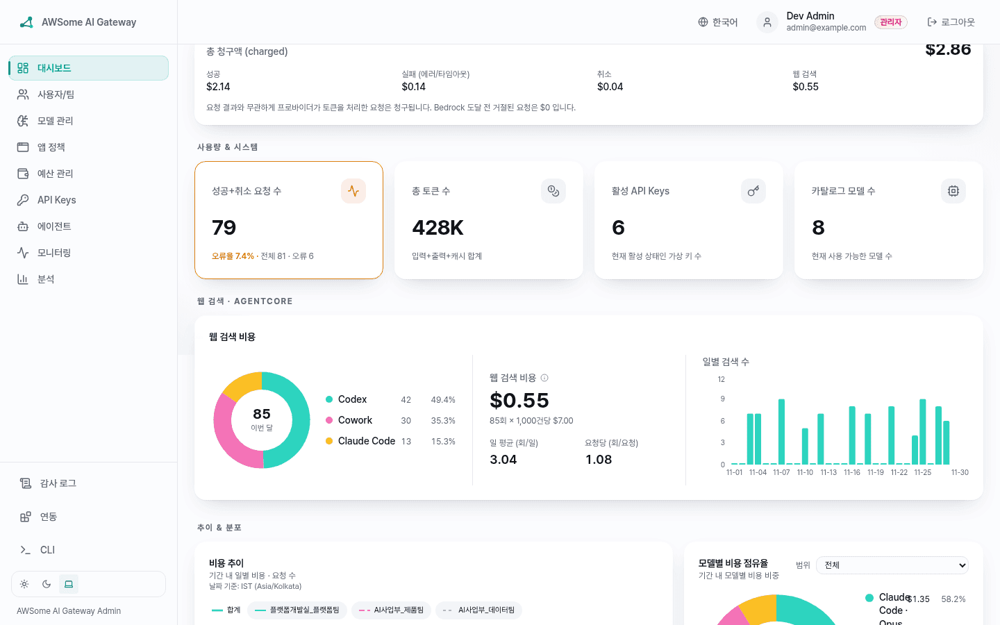

### 무엇이 달라졌나

1. **총 청구액 카드가 분해 표시를 갖게 됐다.** 성공·실패/타임아웃·취소·웹 검색 비용을 나누어 보여 준다.
2. **웹 검색 카드가 추가/보강됐다.** 월 검색 횟수, 웹 검색 비용, 요청당 검색 횟수, 미추적 여부를 함께 읽을 수 있다.
3. **데이터 기준 시각이 표시된다.** 과거는 롤업, 오늘은 실시간 보정이라는 점을 화면에서 확인할 수 있다.
4. 대표 요청 KPI는 이제 성공 + 취소다.
5. 앱별 비용 비중에는 모델 비용만 기준이라는 안내가 붙는다.

### 왜 바뀌었나

기존 화면은 성공 요청 중심으로 보여 실패나 취소 전까지 프로바이더가 처리한 비용이 설명되지 않았다. 운영자가 “성공 비용의 합”과 “실제 청구액”이 다르게 보이는 이유를 알기 어려웠다. 이번 변경은 화면 숫자가 청구 기준과 일치하도록 맞추고, 취소를 서비스 실패로 오해하지 않게 하기 위한 것이다.

### 읽는 방법

- `Total charged`/총 청구액이 가장 중요한 청구 기준 숫자다.
- 분해에서 `실패` 또는 `취소`가 크면, 요청은 실패했지만 모델이 일부 처리되어 비용이 발생한 것이다. 모니터링에서 같은 기간의 에러/타임아웃/취소를 함께 확인한다.
- 웹 검색 비용이 `미추적`이면 $0이 아니라 비용 이력이 없는 상태다. 과거 데이터는 `$7 / 1,000회` 기준의 소급 백필이 적용될 수 있으며, 그 소급분은 예산 재계산으로 넣지 않는다.
- `요청당`은 `회/요청`, `일 평균`은 `회/일` 단위다.

### 운영 팁

- 오늘 수치가 빠르게 변하는 것은 정상이다. 오늘분은 실시간 원본을 반영한다.
- amber 기준 시각 배지가 있으면 롤업 지연 가능성이 있다. 비용 급증 판단 전에 새로고침하고, 지속되면 롤업 작업 상태를 확인한다.
- 웹 검색 비용은 총 청구액에 들어가지만 예산 사용률에는 들어가지 않으므로 두 숫자가 다르게 움직일 수 있다.

---

## 2. 분석 (`/analytics`, `/analytics/models`)

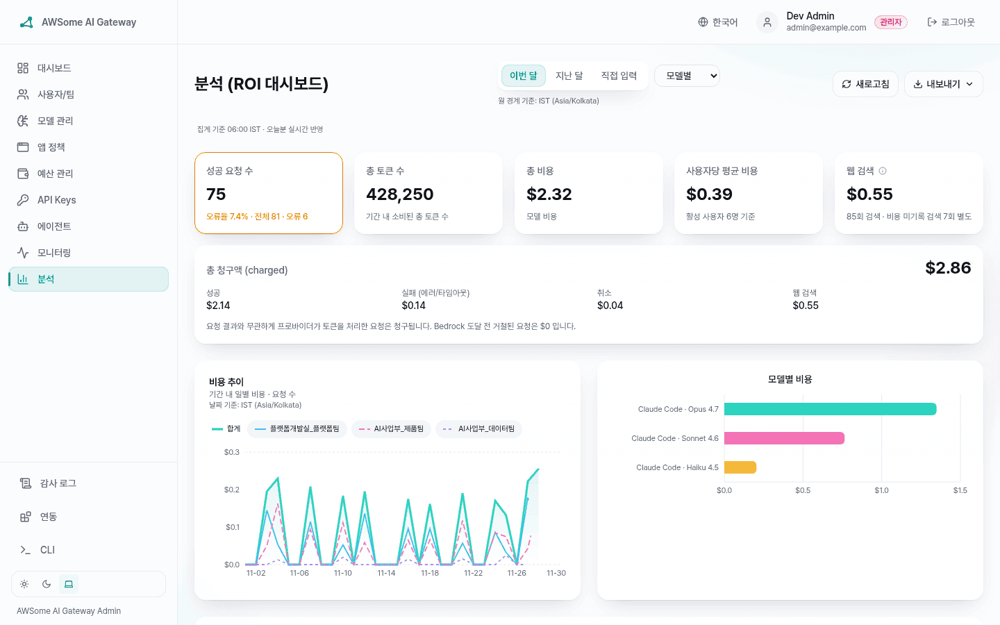

### 무엇이 달라졌나

1. 기간 선택은 **월 선택 또는 사용자 지정 날짜 범위**만 사용한다.
2. 잘못된 사용자 지정 범위는 조용히 임의 기간으로 바꾸지 않고 쿼리를 보내지 않는다. 필터에서 이유를 확인할 수 있다.
3. 비용 요약 응답에 취소 요청 수와 총 청구액 분해가 추가됐다.
4. 사용자×모델 표는 서버가 계산한 범위 전체 합계(`scope_total`)를 사용해, 현재 페이지 합계와 전체 범위 합계를 혼동하지 않게 했다.
5. 웹 검색 카드에 가격 정보, 미배포/미추적 상태, 단위 안내가 추가됐다.
6. 웹 검색을 별도로 보여 주는 구간에서는 모델 비용 카드가 “모델 비용만”이라는 점을 명시한다.

### 왜 바뀌었나

과거에는 페이지네이션된 표의 합계가 전체 범위 합계처럼 보일 수 있었고, 웹 검색 비용과 모델 비용이 섞여 보였다. 또 실패/취소된 처리 비용이 빠져 실제 청구액과 차이가 있었다. 이번 변경은 분석 화면을 청구 기준과 같은 언어로 맞추기 위한 것이다.

### 읽는 방법

- 월별 비교가 필요하면 월 선택을 사용한다. 임의 기간 분석이 필요하면 시작일과 종료일을 모두 올바르게 넣는다.
- 표의 개별 행은 페이지 단위 목록이고, 상단/합계 숫자는 선택한 범위 전체의 서버 합계다.
- 웹 검색 카드의 가격 `ⓘ`는 적용 단가와 추적 시작 여부를 설명한다.
- 미배포 amber 배지는 웹 검색 비용 추적 기능이 아직 해당 환경에 배포되지 않았음을 의미한다.
- 사용자×모델 표에서 전체 합계와 행 합계가 다르면, 표가 일부 페이지만 보여 주는 것인지 먼저 확인한다.

### 운영 팁

비용 이상 원인을 찾을 때는 분석에서 모델별/사용자별 범위를 좁힌 뒤, 모니터링의 상태 분포와 본문 로그로 이동하는 순서가 빠르다. 총 청구액은 크지만 에러율이 낮다면 정상 성공 사용 증가일 가능성이 높고, 실패 비용이 크면 타임아웃·프로바이더 오류·중단된 스트림을 우선 확인한다.

---

## 3. 사용자/팀 (`/users`)

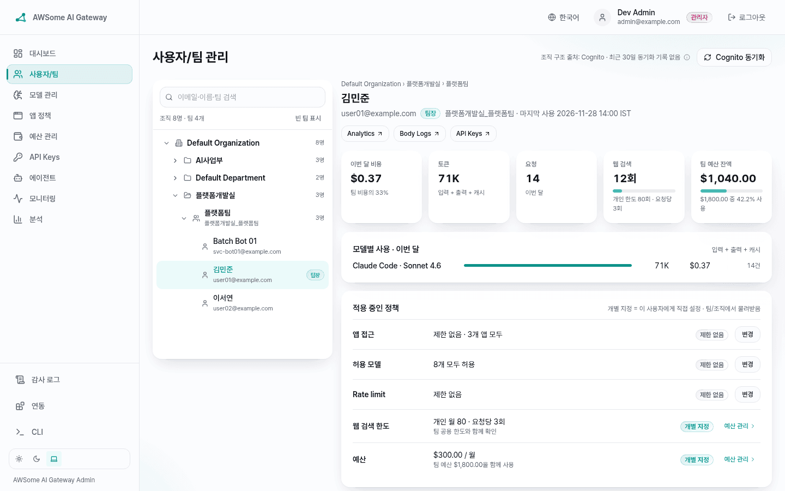

### 무엇이 달라졌나

1. 조직 트리 초기 로딩이 slim 응답으로 최적화됐다. 큰 조직에서 초기 페이로드가 줄어든다.
2. 팀 저장 후에는 전체 트리를 다시 받지 않고 변경된 팀만 부분 갱신한다. 부분 갱신이 불가능하면 전체 트리로 안전하게 폴백한다.
3. 사용자 상세의 팀 사용량 조회가 서버 전체 합계를 이용해 불필요한 페이지 반복 호출을 줄였다.
4. 여러 카드가 같은 데이터를 요청할 때 짧은 시간 동안 요청을 공유해 중복 호출을 줄였다.
5. 빈 팀 표시 토글 실패 시 화면 상태와 실제 데이터가 어긋나지 않도록 오류 알림과 롤백 처리가 보강됐다.

### 왜 바뀌었나

사용자 수가 많은 조직에서 트리 전체를 반복적으로 내려받으면 저장 후 화면 반영이 느려지고 서버 부하가 커졌다. 이번 변경은 주로 성능과 안정성 개선이다.

### 달라진 사용법

화면 조작 방법 자체는 바뀌지 않았다. 다만 저장 직후 해당 팀만 빠르게 갱신되므로, 전체 목록이 깜빡이며 재로딩되지 않아도 정상이다. 부분 갱신에 실패하면 전체 새로고침으로 돌아가며 오류 토스트가 보일 수 있다.

### 운영 팁

- 사용자 상세에서 팀 대비 비중은 서버가 계산한 팀 전체 합계를 기준으로 한다. 현재 화면에 보이는 몇 개 행만 더한 값이 아니다.
- 큰 조직에서도 로딩이 빨라졌지만, 트리 오류 토스트가 반복되면 사용자 동기화나 admin-api 응답 지연을 확인해야 한다.

---

## 4. 예산 (`/budgets`)

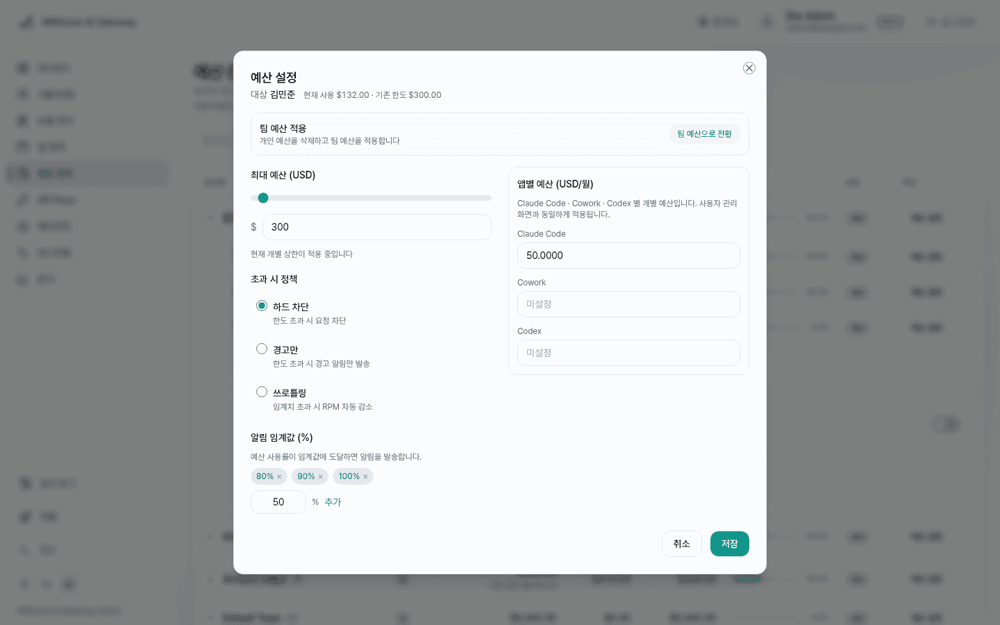

### 무엇이 달라졌나

1. 예산 설정 대화상자가 현재 정책과 알림 임계값을 서버에서 미리 읽어 보여 준다.
2. 금액만 바꿔 저장할 때 기존 enforcement 정책이나 임계값이 기본값으로 되돌아가지 않는다.
3. 팀의 기본 사용자 cap은 값이 바뀐 경우에만 전송한다. 다른 값만 바꾼 저장이 기존 cap을 덮어쓰지 않는다.
4. 409 확인이 필요한 저장을 재시도할 때 이미 성공한 쓰기를 다시 수행하지 않아 중복 audit과 중복 PUT을 줄였다.
5. `0`은 유효한 값이다. 예산을 `0`으로 저장하면 명시적 차단이다.
6. 사용자 범위에서는 Claude Code/Cowork/Codex 같은 앱별 예산을 함께 볼 수 있다.
7. `AICM_MANAGED_LOCK_ENABLED`가 켜진 환경에서는 AICM이 마지막으로 쓴 필드에 `AICM에서 관리됨` 배지와 `잠금 해제` 링크가 표시된다.

### 왜 바뀌었나

기존에는 금액만 고치려다 정책이 기본값으로 저장되거나, 확인 재시도가 동일 쓰기를 반복할 수 있었다. 또 외부 비용 관리 시스템(AICM)이 쓴 값을 사람이 모르고 덮어쓰면 두 관리 주체가 계속 충돌할 수 있었다.

### 예산과 enforcement 읽기

- HARD_BLOCK: 한도 100%에서 차단한다.
- SOFT_WARNING: 한도 100%를 넘으면 경고 상태가 되고, 설정된 soft limit(기본 110%)까지 허용한다.
- THROTTLE: 금액 초과로 바로 차단하지 않고 요청 속도를 줄이는 정책이다.
- 한도 `0`은 정책과 무관하게 차단이다. “아직 설정하지 않음”이 아니라 “사용 금지”로 해석해야 한다.
- 웹 검색 비용은 위 예산 판정에 포함되지 않는다.

### 앱 그룹 예산 (`claude-code`, `cowork`)

- 앱 그룹은 현재 `claude-code`와 `cowork` 두 개만 신규 설정할 수 있으며, 각각 같은 이름의 앱과 1:1로 연결된다.
- 같은 사용자에게 앱별 예산과 앱 그룹 예산이 동시에 있으면 gateway가 두 계층을 함께 평가한다.
- 실효 차단 한도는 사실상 **더 낮은 쪽(min)** 이다. 예를 들어 앱별 cap이 $50이고 그룹 cap이 $30이면 $30에서 먼저 enforcement가 걸린다.
- 앱 그룹 예산을 `PUT 0`으로 설정하면 해당 앱 사용을 즉시 차단하는 의미다. 삭제하려면 명시적으로 DELETE/clear 해야 한다.
- 이 계층 구조는 화면에 별도의 “그룹 편집기”가 생겼다는 뜻이 아니라, 예산 enforcement 해석이 달라졌다는 뜻이다. AICM 또는 API로 설정된 그룹 값이 있으면 사용자의 앱별 예산만 보고 실제 상한을 판단하면 안 된다.

### `AICM에서 관리됨` 배지와 잠금 해제

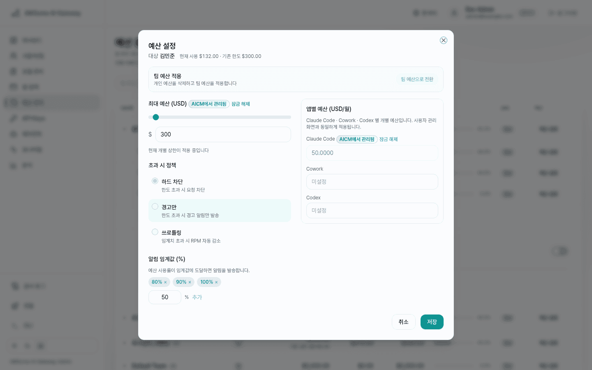

- 배지가 보이면 해당 필드는 AICM이 마지막으로 설정한 값이다.
- 잠금이 적용된 필드는 입력·슬라이더·관련 액션이 비활성화된다.
- `잠금 해제`를 누르면 사유 입력을 요구한다. 사유는 audit에 남는다.
- 해제 후에는 사람이 편집할 수 있지만, 다음 AICM 쓰기가 들어오면 다시 잠길 수 있다.
- 사람 admin이 API로 잠긴 필드를 직접 바꾸려 하면 409 `aicm_managed`가 반환될 수 있다. 이는 일반적인 validation 오류가 아니라 관리 주체 충돌 방지다.
- 이 기능은 `AICM_MANAGED_LOCK_ENABLED=false` 기본값에서는 화면에 나타나지 않는다. 배지가 보이지 않는다고 해서 AICM 연동이 없는 것은 아니다.

### 웹 검색 쿼터

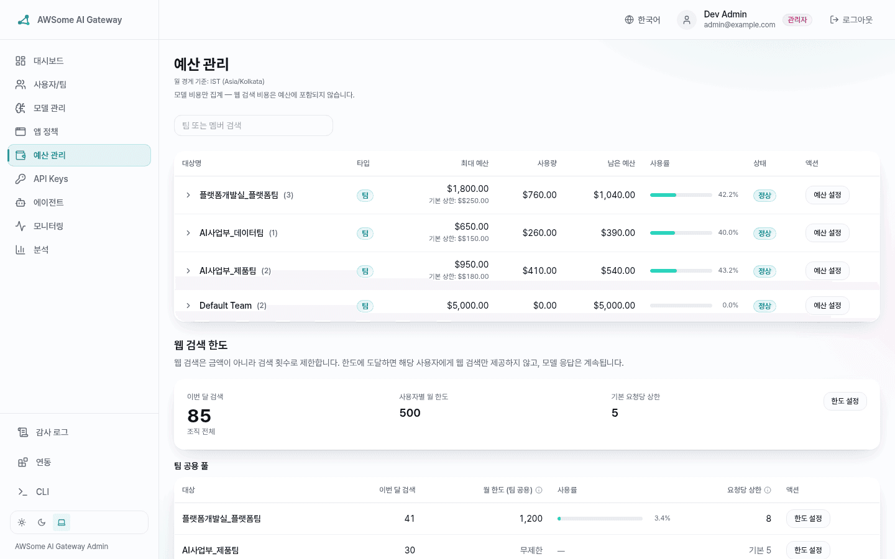

예산 화면 하단의 웹 검색 쿼터는 예산 금액과 별개다.

- 조직 기본값 → 팀 공통 풀 → 사용자별 override 순으로 상속된다.
- 값이 비어 있으면 상위 정책을 상속한다.
- `0`은 웹 검색을 끄는 값이다.
- 사용자 override가 있으면 팀/조직 기본값보다 우선한다.
- 변경은 약 30초 정도 전파 지연이 있을 수 있다.
- `회/월`은 월 총량, `회/요청`은 한 요청 안에서의 최대 검색 횟수다.

### 운영 팁

- 저장 후 정책이 기본값으로 바뀌는 문제는 해결됐다. 그래도 저장 전에 표시된 정책과 임계값을 확인하는 습관은 유지한다.
- 409 확인창은 “위험한 변경을 한 번 더 확인”하는 흐름이다. 확인 후에도 실패하면 화면 오류를 그대로 기록해 둔다.
- AICM 배지 필드를 자주 수동 해제해야 한다면 운영 정책이 외부 시스템과 충돌하는 것이므로, 임시 해제를 반복하지 말고 소유권을 정리해야 한다.

---

## 5. 모델 (`/models`)

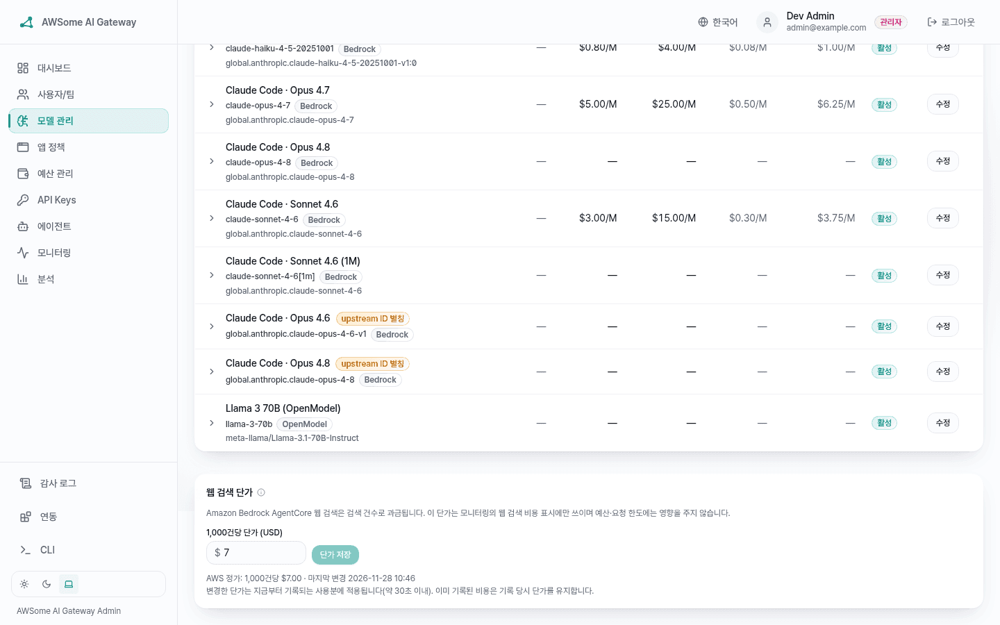

### 무엇이 달라졌나

모델 카탈로그 화면의 웹 검색 단가 카드가 비용 분석과 연결된다. 웹 검색 비용은 모델 토큰 단가와 별도 가격으로 관리되며, 분석/대시보드의 웹 검색 카드는 이 가격과 추적 시작 시점을 이용해 해석한다.

### 읽는 방법

- 모델 토큰 비용과 웹 검색 비용은 별도 항목이다.
- 웹 검색 단가를 바꾸면 이후 추적되는 비용 해석에 영향을 줄 수 있지만, 이미 소급 백필된 역사적 비용은 당시의 고정 단가 정책으로 보존될 수 있다.
- 미추적 상태는 단가가 없어서 $0이라는 뜻이 아니다.

---

## 6. API 키/서비스 계정 (`/keys`, `/agents`, `/service-accounts`)

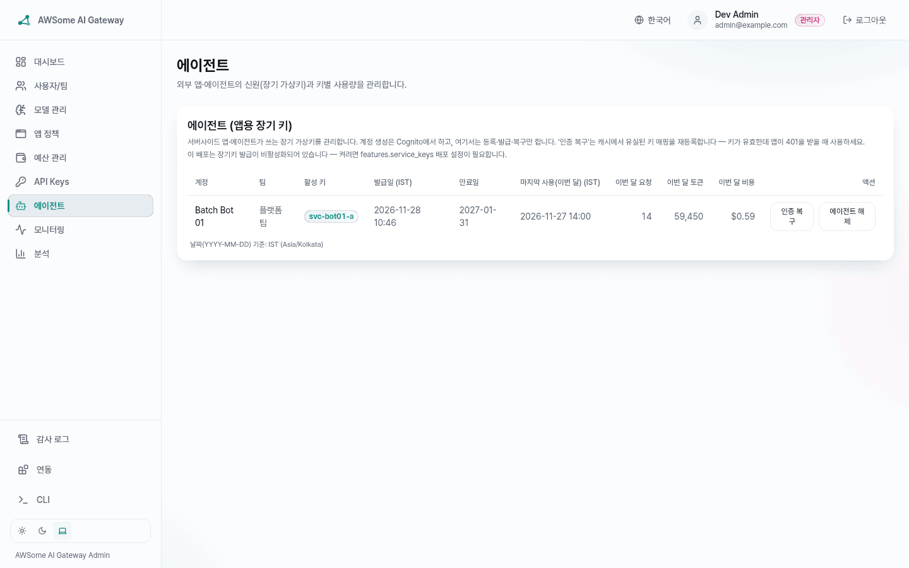

### 무엇이 달라졌나

UI 레이아웃보다 토큰 회전 계약이 중요하게 바뀌었다.

- 서비스 토큰은 이제 **자기 자신만 회전**할 수 있다.
- 사람 admin은 서비스 토큰을 대신 회전하지 않는다. 새 토큰을 발급하고 기존 토큰을 revoke하는 방식으로 교체한다.
- 회전하면 기존 토큰은 유예 기간 동안만 인증되고, 유예가 끝나면 401이 된다.
- 유예 중인 토큰을 다시 회전할 수는 없고 후속 토큰으로 회전해야 한다.
- 연쇄 회전으로 유예 중 토큰이 무한히 쌓이는 것을 막기 위해 lineage 기준 rate limit이 있다. 제한에 걸리면 429와 `Retry-After`가 반환된다.
- 중간 토큰을 revoke하면 그 계열의 후속 토큰도 함께 무효화될 수 있다.

### 왜 바뀌었나

이전에는 의도와 달리 사람도 서비스 토큰도 사실상 회전을 제대로 못 하거나, 반대로 서비스 토큰이 계속 자기 계열을 영속화할 수 있는 경로가 있었다. 이번 변경은 회전 권한을 “서비스 토큰 자가 회전”으로 명확히 하고, 동시 회전·연쇄 회전의 남용을 막는다.

### 운영 방법

1. 토큰 소유 시스템이 새 토큰을 받을 수 있으면 기존 토큰으로 rotate를 호출하게 한다.
2. 소유 시스템이 회전할 수 없으면 사람 admin이 새 토큰을 발급하고 배포한 뒤 기존 토큰을 revoke한다.
3. 유예 기간 중 이중 실행이 필요한 경우에만 기존 토큰을 유지한다. 유예 종료 후 401은 정상이다.
4. 429가 나오면 즉시 반복하지 말고 `Retry-After`까지 기다린다.

---

## 7. 모니터링 (`/monitoring`, `/monitoring/body-logs`)

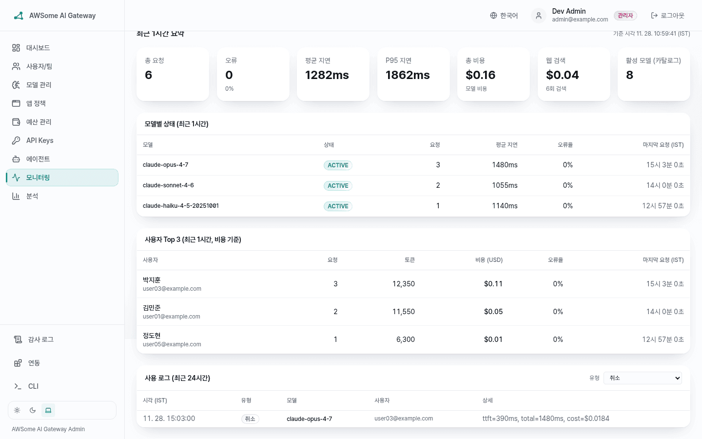

### 무엇이 달라졌나

1. 이벤트 유형 필터와 배지에 `CANCELLED`가 추가됐다.
2. 본문 로그의 호출 상태 배지도 취소를 알려진 상태로 표시한다.
3. 실시간 RPM 사용량 카드는 세션 만료(401)를 일반 조회 실패와 구분한다. 세션이 만료되면 폴링을 계속하는 대신 로그인 흐름으로 보낼 수 있게 됐다.
4. 본문 로깅 토글은 여전히 모니터링 화면 최상단에 있다. 켜져 있으면 사용자 프롬프트/응답 본문이 저장될 수 있으므로 화면을 열자마자 확인해야 할 상태다.

### 왜 바뀌었나

취소된 스트림은 에러와 성격이 다르다. 클라이언트가 연결을 끊은 경우가 많아 서비스 장애와 구분해야 한다. 세션 만료를 조회 실패와 구분하지 않으면 만료된 탭이 계속 조용히 폴링하면서 운영자가 원인을 알기 어렵다.

### 읽는 방법

- `ERROR`/`TIMEOUT`은 서비스나 프로바이더 처리 실패 가능성을 우선 의심한다.
- `CANCELLED`는 사용자 중단, 클라이언트 타임아웃, 네트워크 종료 가능성을 본다.
- 취소가 늘어도 대시보드 에러율이 그대로일 수 있다. 이는 계산 정책상 정상이다.
- 본문 로그에서 취소 상태를 보고 비용이 발생한 경우, 취소 전까지 모델이 토큰을 처리했을 수 있다.

### 알림 연동

Alertmanager/Slack alerting과 business alerts는 Admin UI의 새 설정 화면이 아니라 배포/워커 설정으로 동작한다.

- Alertmanager 계열: 인프라/런타임 알림
- business alerts: reconciliation mismatch, dead-letter 증가, pricing missing
- 기본값은 모두 비활성이며, Slack webhook은 Secret 참조로 주입한다. 값이 없으면 Slack wiring이 없다.
- 알림을 받았다면 Admin UI의 모니터링/분석에서 같은 기간을 열어 비용·상태·모델별 분포를 대조한다.

---

## 8. 감사 (`/audit`)

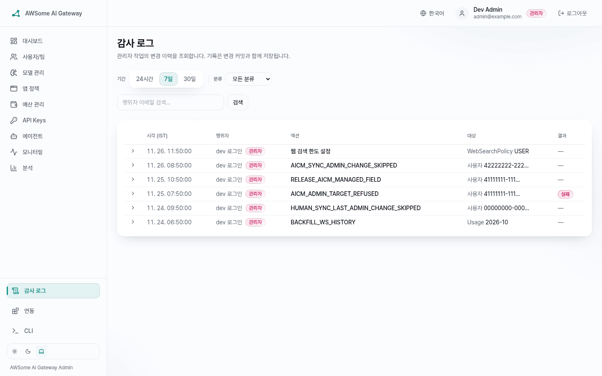

### 무엇이 달라졌나

감사 목록의 화면 구조보다 **새로 기록되는 액션 종류**가 늘었다.

대표적으로 다음과 같은 계열이 나타날 수 있다.

- `AICM_ADMIN_TARGET_REFUSED`: AICM 또는 외부 연동이 보호된 관리자/서비스 계정 대상을 변경하려다 거부됨
- `AICM_SYNC_ADMIN_CHANGE_SKIPPED`: Cognito 동기화 중 관리자 권한 변경이 안전상 건너뛰어짐
- `HUMAN_SYNC_LAST_ADMIN_CHANGE_SKIPPED`: 마지막 관리자 보호 규칙 때문에 사람 동기화 변경이 적용되지 않음
- `BACKFILL_WS_HISTORY`: 역사적 웹 검색 비용 소급 백필
- managed-field release: `AICM에서 관리됨` 잠금을 사람이 사유를 들어 해제한 기록

### 읽는 방법

- 409 `aicm_managed`가 발생하면 감사에서 해당 필드의 마지막 AICM 쓰기와 잠금 해제 이력을 확인한다.
- 웹 검색 과거 비용이 바뀐 것처럼 보이면 `BACKFILL_WS_HISTORY` 실행 여부와 기간을 확인한다.
- Cognito 동기화 후 기대한 관리자 권한 변경이 없으면 skipped 계열 audit을 확인한다. 마지막 관리자 보호로 의도적으로 막힌 것일 수 있다.

---

## 9. 로그인/세션 흐름

위 화면은 로컬/개발용 `DEV_LOGIN_ENABLED=true` 진입 화면이다. 운영 배포의 로그인 화면은 아래 Cognito hosted UI 절을 참조한다.

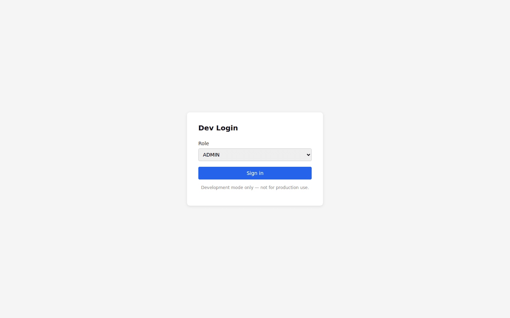

세션 만료 판정 후에는 보호 페이지 대신 로그인 진입점으로 돌아온다. 로컬 개발 모드에서는 같은 dev-login 화면이 결과로 보인다.

로그아웃은 로컬 `admin_jwt`와 역할 보조 쿠키를 지우고 로그인 진입점으로 돌아간다. OIDC 배포에서는 IdP 세션 종료를 위한 제공자 로그아웃 위치로 먼저 이동할 수 있다.

### 무엇이 달라졌나

- Admin UI는 이제 페이지를 열기 전에 세션 만료를 검사한다.
- 만료된 `admin_jwt`로 페이지가 열린 채 모든 API만 401이 되어 화면이 `—`와 fetch 오류로 채워지던 문제가 줄었다.
- 만료된 세션은 로그인 진입점으로 리다이렉트되고 쿠키가 정리된다.
- 시계 오차를 고려해 UI는 서버보다 약 30초 일찍 만료로 판정한다. 이는 보수적인 UX 판정이며 실제 권한 판정은 admin-api가 다시 수행한다.
- 만료 값이 아예 없는 일부 IdP 토큰은 로그인 직후 무한 리다이렉트를 막기 위해 만료로 보지 않는다. 대신 콜백에서 쿠키 수명을 제한한다.
- 로그인 콜백은 토큰의 `exp` 또는 `expires_in`을 읽어 `admin_jwt` 쿠키 수명을 정한다. 둘 다 읽지 못할 때만 짧은 1시간 폴백을 쓰고, 쿠키 수명은 상한 12시간·하한 60초로 제한한다. 임시 OIDC 쿠키는 성공/실패 후 정리한다.
- 콜백은 admin-api가 판정한 실제 역할을 별도 `admin_role` 쿠키로 구워 TEAM_LEADER/DEVELOPER 접근을 구분한다. 이 과정이 실패하면 `admin_jwt`를 세팅하지 않는다.
- 만료 값이 있는데 해석할 수 없으면 손상/비표준 토큰으로 보고 fail-closed, 즉 만료로 처리한다.
- JWT NumericDate는 정수뿐 아니라 소수 형태도 해석한다.

### Cognito hosted UI 참고

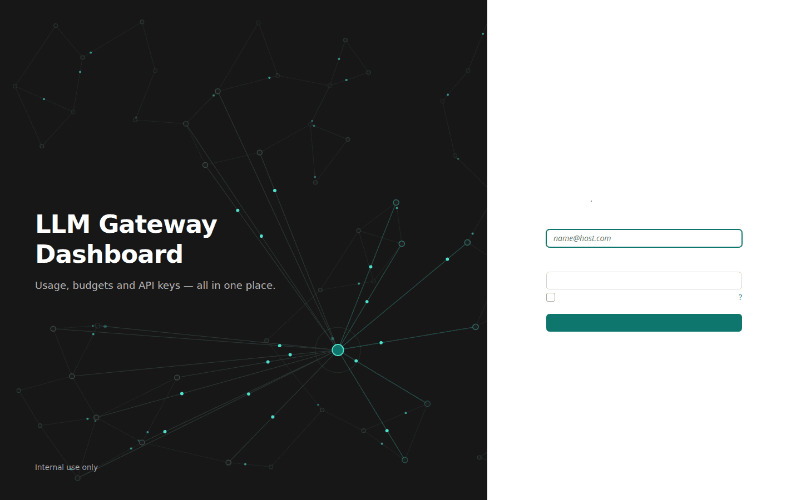

로그인 화면 자체는 AWS 관리형 hosted UI를 사용하는 환경에서는 AWS가 제공하는 화면이다. 이 저장소의 Admin UI 코드와 별개이며, 이번 배포에서 hosted UI의 시각적 디자인을 직접 변경한 것은 아니다. 위 캡처는 로그인 진입까지만 확인한 것이며 자격 증명 입력이나 로그인 제출은 수행하지 않았다. 문서와 스크린샷에는 내부 도메인이나 쿼리 값을 포함하지 않는다.

Admin UI가 통제하는 범위는 로그인 진입 리다이렉트, OIDC `state`/PKCE 임시 쿠키, 콜백 검증, `admin_jwt`·`admin_role` 쿠키 발급과 수명, 그리고 로그아웃 리다이렉트까지다. 반대로 Cognito hosted UI의 렌더링, IdP federation 화면 전환, 비밀번호 정책, MFA 정책/장치 등록, 비밀번호 재설정과 AWS/IdP 측 오류 메시지는 AWS Cognito와 연결된 IdP가 관리한다. 이들 화면의 문구나 동작은 Admin UI 배포의 회귀로 해석하면 안 된다.

### 운영자가 체감하는 변화

- 오래 열어 둔 탭에서 데이터가 갑자기 전부 비어 보이기보다 로그인 화면으로 이동하는 것이 정상이다.
- 로그인 후에도 즉시 로그인으로 반복 이동하면 정상적인 세션 계약이 아니므로 환경별 콜백/쿠키 설정을 점검해야 한다.

---

## 10. 설정/알림 관련 화면

별도의 `/settings` 화면이 새로 생긴 것은 아니다. 이번 라운드에서 운영자가 알아야 할 설정성 변경은 다음 위치에 나뉘어 있다.

- 웹 검색 단가: `/models`의 웹 검색 단가 카드
- 웹 검색 쿼터: `/budgets` 하단
- 본문 로깅: `/monitoring` 상단
- Slack/business alerts: Admin UI 화면이 아니라 배포 값과 notification-worker 설정

---

## 11. 변경되지 않은 것

- 기존 화면의 기본 정보(대시보드, 사용자, 모델, 앱, 예산, 키, 모니터링, 분석, 감사)는 유지된다.
- 예산 enforcement는 여전히 모델 토큰 비용 기준이다. 웹 검색 비용이 HARD_BLOCK 계산에 들어가지 않는다.
- TEAM_LEADER가 접근할 수 있는 기본 범위는 크게 바뀌지 않았다. 예산/분석은 허용되고, 대부분의 관리 기능은 ADMIN 중심이다.
- Cognito hosted UI 자체의 AWS 제공 디자인은 Admin UI 배포로 바뀌지 않는다.
- 웹 검색 과거 비용 소급은 예산 사용량이나 Redis 카운터를 다시 쓰지 않는다. 과거에 예산 초과로 차단되지 않았던 것을 사후에 차단한 것처럼 만들지 않는다.
- 서비스 토큰의 발급/목록/revoke 같은 기본 관리 개념은 유지된다. 바뀐 것은 회전 권한과 lineage 안전장치다.
- 모니터링의 상태별 원시 이벤트 수와 비용 화면의 계량 요청 수는 서로 다른 목적의 지표로 유지된다.

## 12. 이상 징후별 빠른 대응

| 증상 | 먼저 볼 것 | 해석 |
|---|---|---|
| 총 청구액은 큰데 성공 비용은 작음 | 대시보드 총 청구액 분해 | 실패/취소 전 처리 비용 또는 웹 검색 비용 |
| 취소가 많은데 에러율은 낮음 | 모니터링 `CANCELLED` 필터 | 취소는 에러율에 넣지 않으므로 정상일 수 있음 |
| 오늘 수치가 계속 바뀜 | 데이터 기준 라벨 | 오늘분 실시간 반영 |
| 웹 검색 비용이 0이 아니라 미표시/미추적 | 웹 검색 카드 가격/배지 | 추적 시작 전 또는 비용 미기록 |
| 예산 100%인데 SOFT_WARNING으로 통과 | 예산 정책 | soft limit까지 허용될 수 있음 |
| `0` 저장 후 모든 호출 차단 | 예산 금액 | 명시적 차단 의도가 맞는지 확인 |
| `AICM에서 관리됨` 때문에 수정 불가 | 배지/잠금 해제/audit | 외부 관리 주체와 소유권 충돌 |
| 오래된 탭이 로그인으로 이동 | 세션 만료 | 만료 세션 정리 동작, 정상 |
