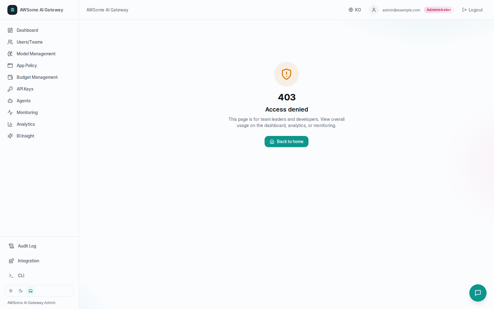

# Access Denied (403)

**Route:** `/403` · **Role:** any authenticated user denied a page

The access-denied page — reached when a signed-in user opens a route
their role is not allowed to see.

## When it appears

- An **Administrator** opening [`/my`](my-usage.md) — that page is
  intentionally team-leader/developer only.
- A **Team leader** or **Developer** opening any admin-only page
  (Dashboard, Models, Apps, Keys, Agents, Monitoring, Audit, …).
- Any authenticated user hitting a route not listed for their role —
  `checkPagePermission` is default-deny.

## Behaviour

- Redirects to `/403` via a same-origin 307 — the URL in the address bar
  stays on the denied path for a moment, then lands here.
- `/403` itself is public so the redirect cannot loop.
- **Back to home** resolves per-role — `/` for administrators, `/my`
  for team leaders and developers.

## Operational notes

- Seeing this page as an admin is expected on `/my` — not a bug.
- If a user hits it on a page they *should* have, check the role badge
  in the header — it shows the role the session was granted. For a
  missing team-leader grant, verify the **Team leader** flag on
  [Users/Teams](users-teams.md) (it is a console flag, not a Cognito
  group); for admin/developer, check Cognito group membership.
- The role comes from the `admin_role` cookie baked by admin-api after
  Cognito callback — a stale cookie after a role change is fixed by
  re-login.
