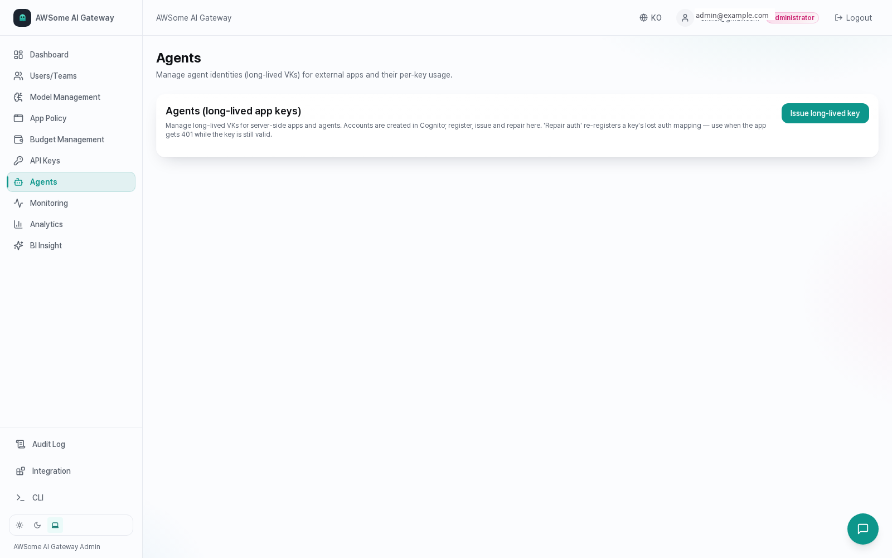
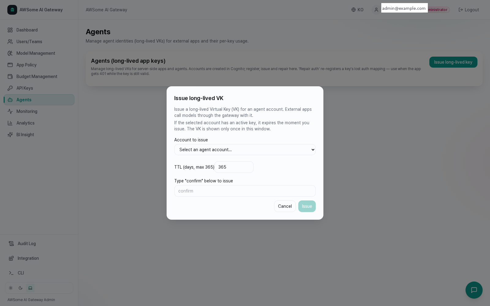
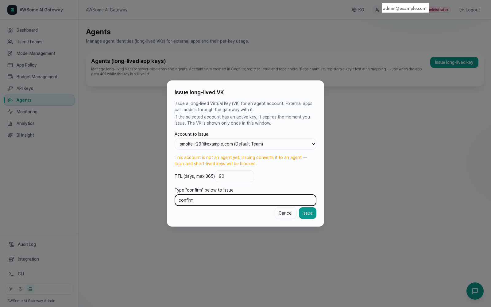
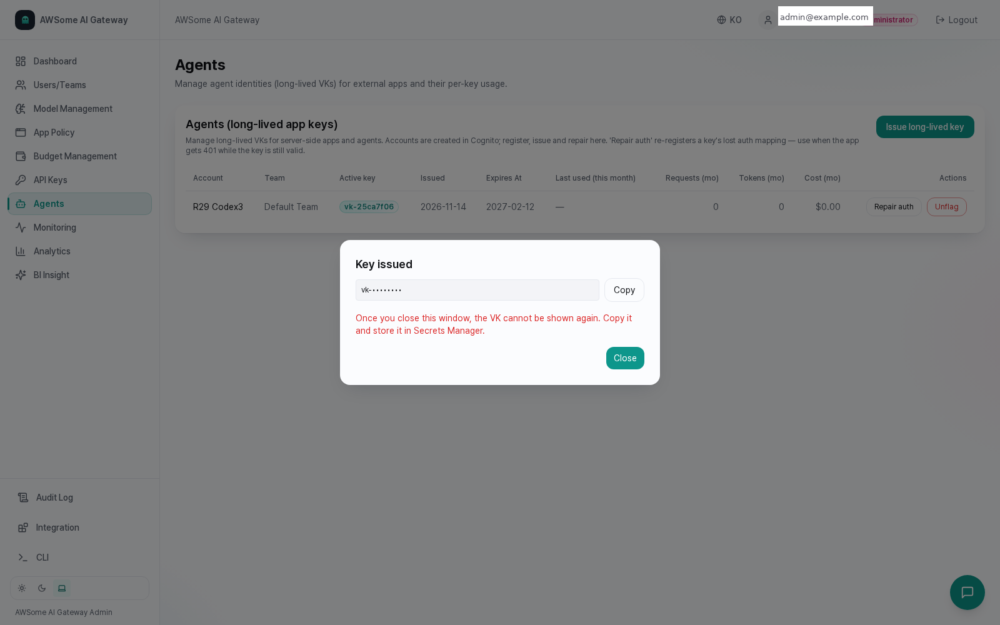
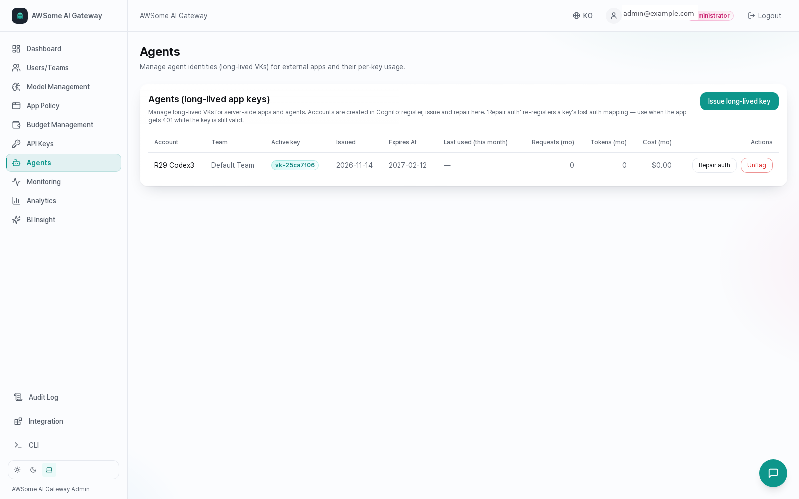
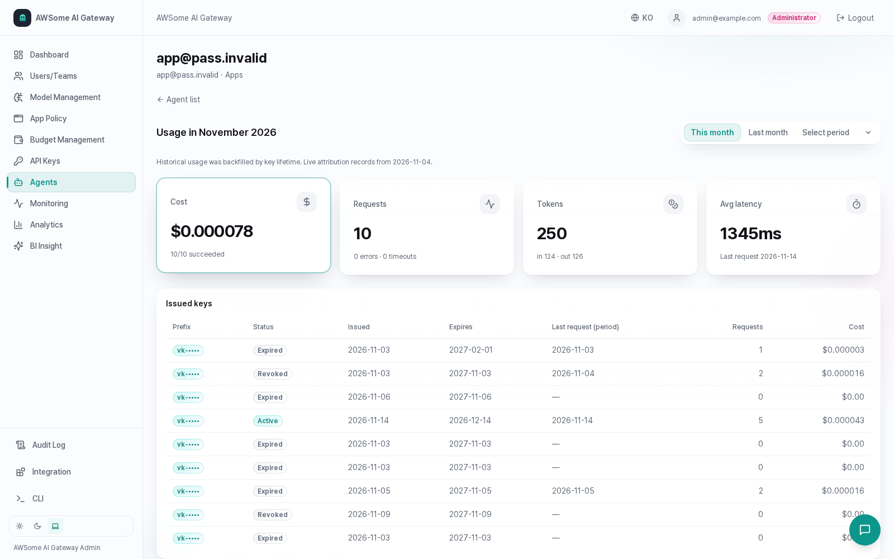
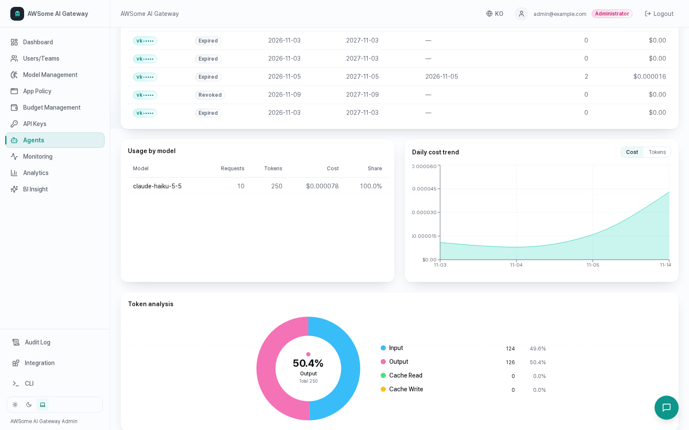

# Agents

**Route:** `/agents` · **Role:** Administrator
*(also serves `/service-accounts`, which redirects here)*

Long-lived virtual keys for server-side apps and agents — identities
created in Cognito, then issued and maintained here.

## Issue long-lived key

**Issue long-lived key** opens a dialog:

1. Pick the **account to issue** — an existing Cognito account that will
   own the key (accounts themselves are provisioned via Cognito, not
   created here). Picking a non-agent account shows a warning that issuing
   **converts it to an agent** — interactive login and short-lived keys
   are blocked for that account afterwards.
2. Set the **TTL** (days, max 365) and type `confirm` into the
   confirmation field — the **Issue** button stays disabled until the
   literal string is entered, which prevents accidental issuance.

3. The plaintext key is shown **once** in a copyable block. Store it in
   Secrets Manager immediately — after this window closes the VK cannot
   be shown again.

The account then appears in the table with its key prefix, issued/expiry
dates, and live monthly counters:

## List actions

| Action | Effect |
|---|---|
| **Repair auth** | Re-registers a key's lost auth mapping. Use when an app gets **401 while the key is still valid** — e.g. after a cache eviction or manual DB edit. |
| **Unflag** | Revokes the account's live service key, then drops the agent marker — the backend refuses to unflag while a live key remains, so the UI revokes the key first and the two happen together. |

Click a row to open the agent's [detail view](#agent-detail).

## Agent detail

**Route:** `/agents/{userId}` · per-agent usage and key inventory —
click a row in the list to open it.

- **Usage KPIs** — cost, request count (succeeded/errors/timeouts),
  tokens (in/out), and average + last-request latency for the selected
  period (This month / Last month / Select period). Historical usage
  is backfilled by key lifetime; live attribution starts from when the
  feature began recording.
- **Issued keys** — every long-lived key on the account: prefix,
  status (Active/Expired/Revoked), issued/expires timestamps, last
  request in the period, and per-key requests and cost — the table to
  check which key is driving spend.

- **Usage by model** — requests/tokens/cost/share per model this agent
  called, plus a daily cost trend (Cost or Tokens) and a token-mix
  donut (input/output/cache).

Use this view to confirm a repair worked — a healthy key has a recent
**last request** and non-zero counters.

## Operational notes

- Rotate keys by **unflagging and re-issuing**: Unflag revokes the live
  key (and the marker), then Issue long-lived key creates a fresh one on
  the same account. Update the secret in Secrets Manager between the two
  steps so the app does not lose access.
- `Unflag` drops the agent marker; key and usage history survive it.
- Audit entries for issue/revoke/repair are under
  [Audit Log](audit-log.md) category *API key*.
