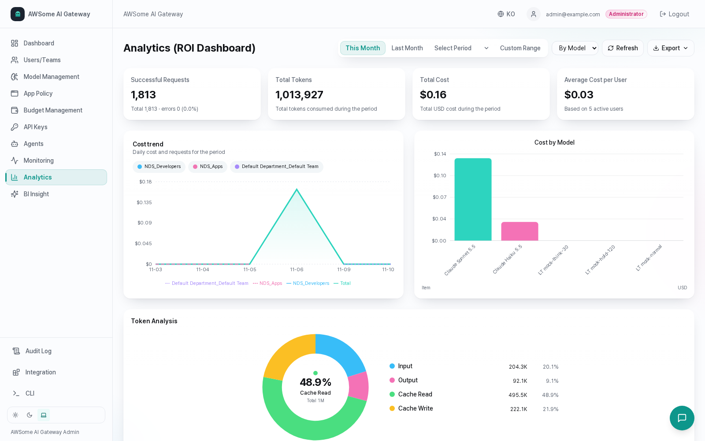

# Analytics (ROI Dashboard)

**Route:** `/analytics` · **Role:** Administrator, Team leader
*(also serves `/analytics/models`, which redirects here)*

Aggregated cost and usage analytics — the reporting counterpart to the
live [Monitoring](monitoring.md) page.

## Filters

| Control | Effect |
|---|---|
| **This Month / Last Month / Select Period** | Month presets and any month in the data. |
| **Custom Range** | Explicit start/end dates. |
| **By Model** | Restricts all charts to one model. |
| **Refresh** | Re-pulls data without changing filters. |
| **Export** | Downloads the current view (CSV). |

## KPI cards

- **Successful Requests** — total and error count/rate.
- **Total Tokens** — all token types combined.
- **Total Cost** — USD for the period.
- **Average Cost per User** — total ÷ active users.

## Charts

- **Cost trend** — daily cost and request lines, one series per team.
- **Cost by Model** — per-model spend bars for the period.
- **Token Analysis** — donut splitting input / output / cache-read /
  cache-write token volumes.
- **Top spenders** and **model cost detail** panels — the *By Model*
  filter drives the per-model drill-down.

## Operational notes

- The `/analytics/models` URL still works — it redirects here with
  `?model=` filters preserved.
- Export produces a CSV of the current filtered view, suitable for
  importing into finance tooling.
- Team leaders see the same charts but scoped to their own team.
