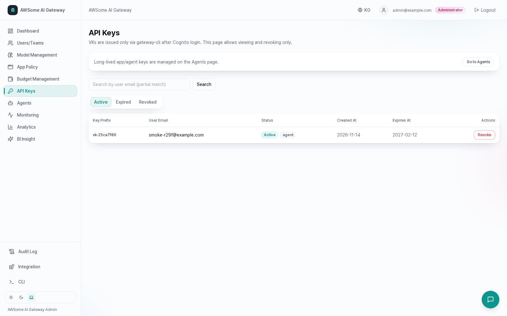
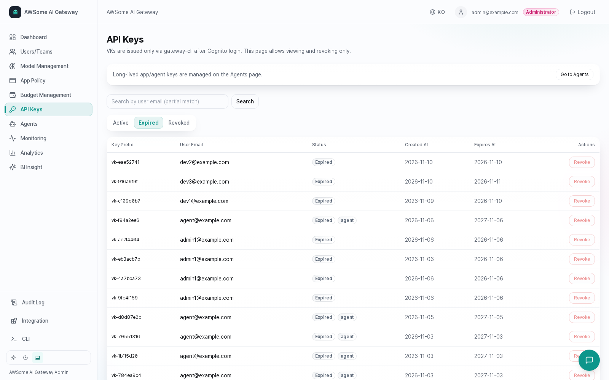
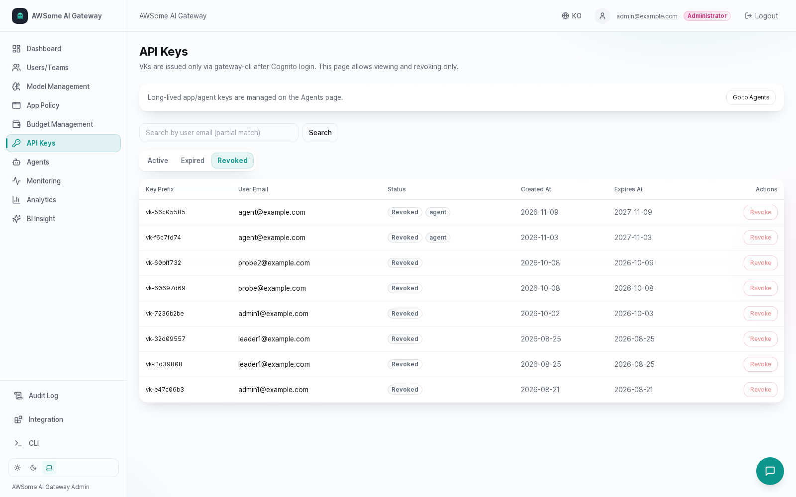

# API Keys

**Route:** `/keys` · **Role:** Administrator

Inventory of **user virtual keys** — the short-lived keys users get
after Cognito login via `gateway-cli`. This page is **view and revoke
only**; keys cannot be issued from the UI.

## Controls

| Control | Effect |
|---|---|
| **Search by user email** | Partial-match filter on the owner's email. |
| **Active / Expired / Revoked** tabs | Filter by key lifecycle state. |

The **Expired** and **Revoked** tabs list keys by lifecycle state —
expired keys remain visible for audit even though they can no longer
authenticate:

## Table

One row per virtual key: owner, masked key prefix, issued/expiry
timestamps, last-use time, status. The only mutation is **revoke** on an
active key.

## Issuing keys

VKs are issued through `gateway-cli` (see [CLI](cli.md)) — after the
browser Cognito login completes, the CLI receives a key automatically.
There is intentionally **no** "create key" button here: issuing from the
UI would put a plaintext key in a browser flow for no operational
benefit.

## Long-lived keys

Application/agent keys (long-lived, no interactive login) are managed on
the [Agents](agents.md) page — use **Go to Agents** from the banner.

## Operational notes

- **Revoke** is immediate — subsequent requests with that key return 401.
- Expired keys are kept listed for audit; they cannot be reactivated.
- If a user reports a 401 on a key that is still `ACTIVE`, the fix is a
  fresh `gateway-cli login` — auth-mapping repair applies only to
  long-lived agent keys on [Agents](agents.md).
