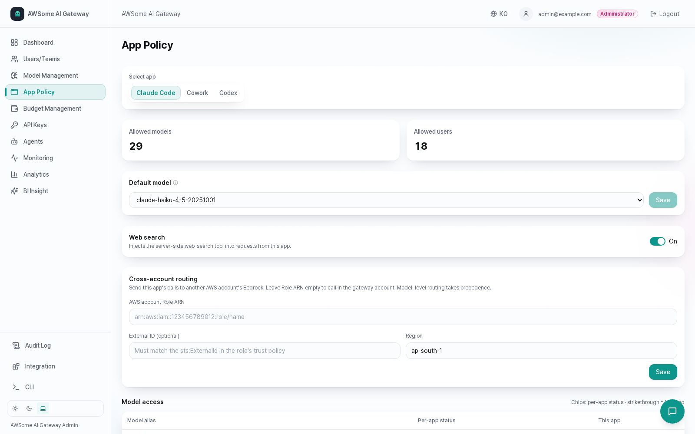

# App Policy

**Route:** `/apps` · **Role:** Administrator

Per-client policy. Select an app (Claude Code, Cowork, Codex) to edit
what its users can do through the gateway.

## App selector

The tabs at the top switch the whole page between client apps. Every
control below applies only to the selected app.

## Summary cards

- **Allowed models** — how many catalog aliases this app may call.
- **Allowed users** — users permitted to authenticate requests as this
  app.

## Controls

| Control | Effect |
|---|---|
| **Default model** | Alias the app falls back to when a request does not name a model. Must be one of the app's allowed models. |
| **Web search** | Injects the server-side `web_search` tool into requests from this app. Applies to every request tagged with the app's client family. |
| **Cross-account routing** | Sends this app's calls to another AWS account's Bedrock: **Role ARN**, optional **External ID** (must match `sts:ExternalId` in the role trust policy), and **Region**. Leave the ARN empty to run in the gateway account. Model-level routing on the model entry takes precedence over this app-level setting. |
| **Model access** | Per-alias chips — per-app status for each model; a struck-through chip means the app is denied that alias. |

## Operational notes

- Changes take effect on the next request — there is no deploy step.
- Cross-account routing is validated at request time: a bad ARN or
  External ID surfaces as a 4xx on the app's calls, so confirm the trust
  policy before saving.
- Users are granted app access on [Users/Teams](users-teams.md)
  (app-access chips per scope); models are granted in the
  **Model access** section here.
