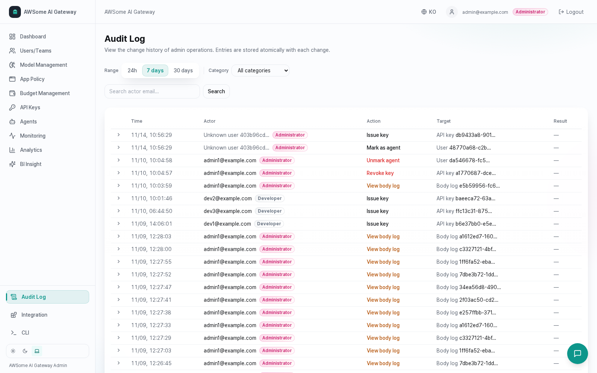
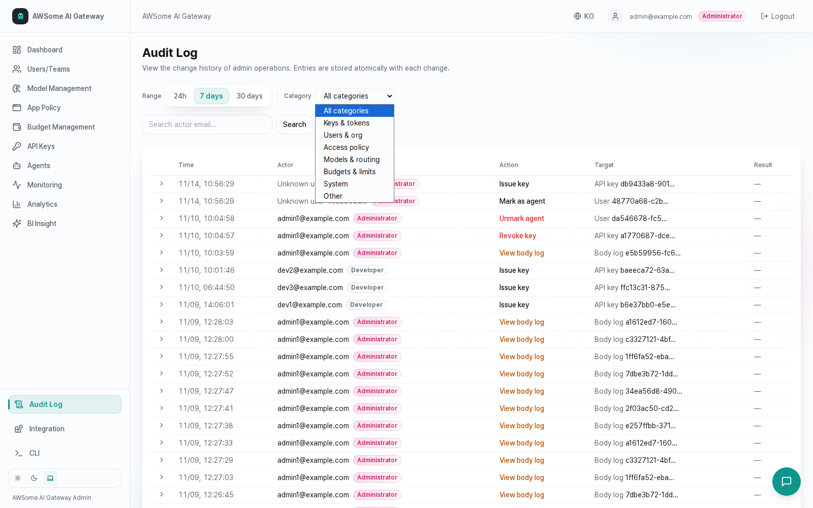
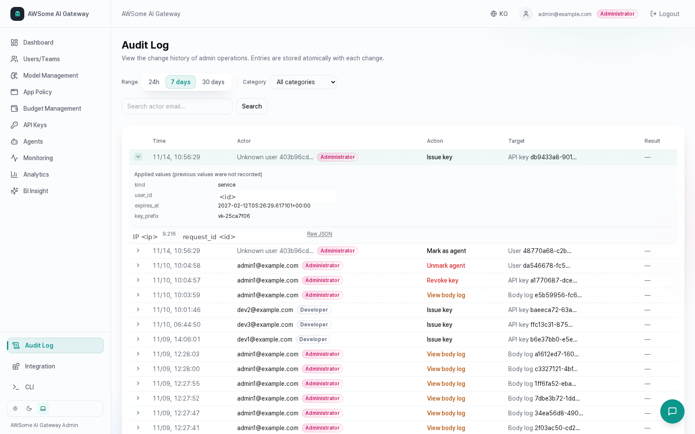

# Audit Log

**Route:** `/audit` · **Role:** Administrator

Append-only record of admin operations — every mutation made through the
console or API lands here with the actor, target, and outcome.

## Filters

| Control | Effect |
|---|---|
| **Range** — 24h / 7 days / 30 days | Time window. |
| **Category** | All categories or one of *API key*, *Agent*, *Body log*, *System setting*, *Model*, *Budget*, *Rate limit*, *Policy*, … |
| **Search actor email** | Partial-match on who performed the action. |
| **Search** | Applies the text filter. |

The **Category** dropdown groups actions — *Keys & tokens*, *Users & org*,
*Access policy*, *Models & routing*, *Budgets & limits*, *System*, *Other*:

## Table

| Column | Meaning |
|---|---|
| **Time** | Timestamp of the operation. |
| **Actor** | Email + role badge of the account that ran it. |
| **Action** | What was done — *Issue key*, *Revoke key*, *View body log*, *Set body logging*, *Unmark agent*, … |
| **Target** | The object affected (key, user, body log, system setting, …). |
| **Result** | Outcome — usually `—` for success, or an error detail on failure. |

## Row expansion

Clicking the `>` marker expands an entry in place — the applied values
(changed fields with new values), plus the request IP and `request_id`
for correlation with backend logs:

## What is recorded

- **Key lifecycle** — issue, revoke, repair.
- **Policy changes** — budget, rate limit, app access, model catalog.
- **Sensitive views** — every body-log read is logged (see
  [Monitoring](monitoring.md#body-logs)).
- **System toggles** — body logging on/off, feature flags.

## Operational notes

- Entries are written atomically with each change — an action that fails
  to commit does not appear here.
- Use it as the first stop when a user reports an unexpected state —
  e.g. "who revoked my key" or "when was body logging turned on".
- The `View body log` rows are themselves sensitive — they prove who
  read unmasked prompt/response data.
