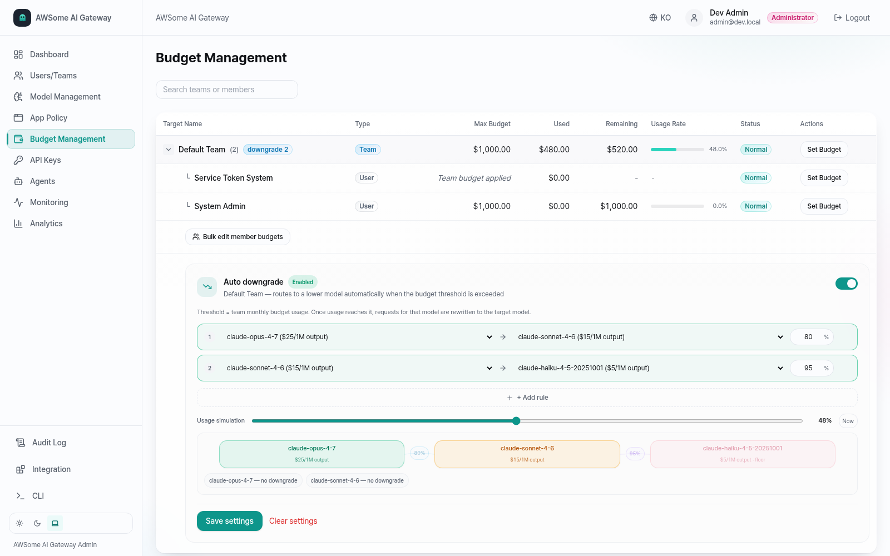
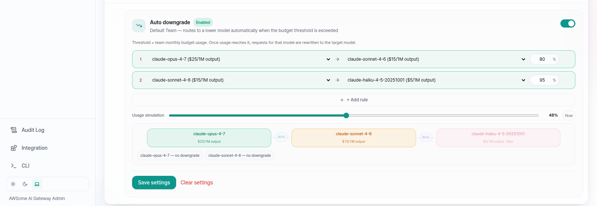
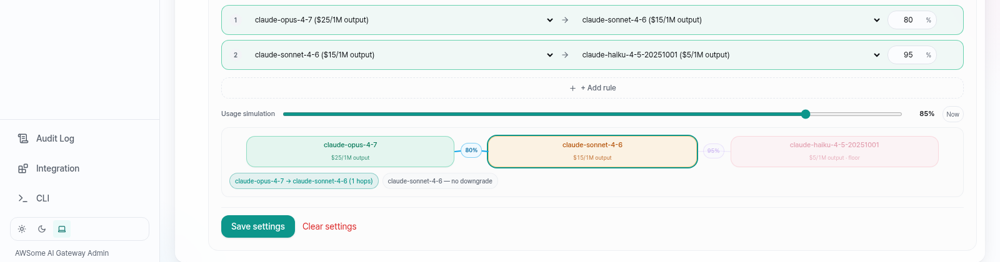
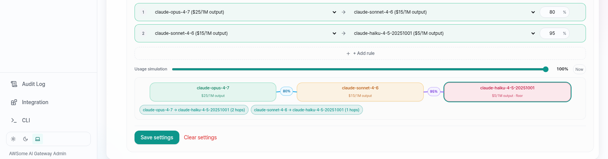

# Auto-downgrade

**Route:** `/budgets` → expand a team row → **Auto downgrade** card ·
**Role:** Administrator, Team leader (own team)

Transparent model fallback driven by team monthly budget usage. When a
member's team crosses a configured usage threshold, requests naming the
flagged model are silently rewritten to a cheaper model **before** the
hard budget cap is reached — spend degrades gracefully instead of
stopping.



## How resolution works

- **Threshold basis** — each rule's percentage is measured against the
  team's *monthly budget usage* (`used / max_budget` for the current
  period). A team **must have a monthly cap set** — without one there
  is no usage ratio and no rule ever fires.
- **Chained rules** — rules resolve transitively. If the usage rate
  passes several thresholds, the effective model follows the chain to
  its floor: e.g. with `opus → sonnet @ 80%` and `sonnet → haiku @ 95%`,
  at 96% usage a request for `opus` resolves straight to `haiku`
  (2 hops), skipping `sonnet`.
- **Safety bounds** — cycles are prevented (a model is never revisited)
  and chain depth is capped at 5 hops.
- **Same provider only** — the *from* and *to* models must share a
  provider (e.g. `BEDROCK → BEDROCK`). Cross-provider rules are rejected
  on save.
- **Authorization preserved** — the downgrade target must be a model the
  caller may use. If the target alias is not usable/authorized, the hop
  is skipped rather than producing an unauthorized request.
- **Scope** — downgrade policies attach to **TEAM** scope only; there is
  no per-user or per-app override.

## Setup



1. **Enable the toggle** (top-right of the card) — the rules editor and
  simulation panel appear. The card header shows an *Enabled* badge once
  saved.
2. **Add rules** with **+ Add rule**. Each row is:

   | Field | Meaning |
   |---|---|
   | *from* model | Alias that gets rewritten once its threshold passes. |
   | → *to* model | Fallback alias — must be same-provider and cheaper in practice. Dropdowns show each alias's output price (`$X/1M output`) so the price drop is visible while editing. |
   | *threshold %* | Team usage percentage at which the rewrite activates. |

   Rows are ordered; each *from* model must be unique. Delete a row with
   the row's trash action.
3. **Save settings** persists the policy — it takes effect on the next
   request (the gateway reads the policy from Redis, falling back to the
   database). **Clear settings** removes the policy entirely and restores
   original routing.

The team row's `downgrade N` badge reports **N configured rules**.

## Usage simulation

The **Usage simulation** slider previews resolution without touching
real traffic — drag it to any percentage and the diagram below rewrites
each source model to its effective target, annotated with the hop count.

At **85%** (`opus → sonnet @ 80`, `sonnet → haiku @ 95`):



`claude-opus-4-7 → claude-sonnet-4-6 (1 hops)`; sonnet itself stays
because 85% < 95%.

At **100%**:



`claude-opus-4-7 → claude-haiku-4-5-20251001 (2 hops)` — the chain
collapses to the floor model, which is marked *floor*.

## What the caller sees

Nothing in the request contract changes — the caller still sends
`"model": "claude-opus-4-7"`. The gateway middleware rewrites the model
before dispatch; the **response `model` field reports the effective
model** actually served, and the request is logged and metered under
that model.

Server-side, each evaluated request emits a `downgrade_mw_evaluated`
log/metric event carrying `original_model`, `effective_model`, `hops`,
`current_pct`, and the applied rule set — observable in the proxy logs
and the `downgrade_applied_total` / `downgrade_chain_depth` metrics.

## API equivalent

The card is a frontend for:

```
PUT /admin/budgets/TEAM/{team_id}/downgrade
{
  "enabled": true,
  "rules": [
    {"from_model_alias": "claude-opus-4-7",   "to_model_alias": "claude-sonnet-4-6",           "threshold_pct": 80},
    {"from_model_alias": "claude-sonnet-4-6", "to_model_alias": "claude-haiku-4-5-20251001",    "threshold_pct": 95}
  ]
}
```

Usage percentages used in the simulation are the same values written by
`PUT /admin/budgets/spent` (testing) or recorded live by the cost
pipeline (production).

## Operational notes

- Order the chain by descending price so each hop meaningfully cuts
  cost — the dropdown price hints make expensive→cheap mistakes visible.
- Thresholds near 100% leave almost no fallback runway before the hard
  cap; a common pattern is 80/95 as above, keeping the cheapest model as
  the floor until the cap blocks.
- Downgrade complements, never replaces, the budget policy — once the
  cap is fully spent, requests are blocked regardless of model.
- A member request that names the floor model directly is unaffected —
  there is no rule to apply and no rewrite occurs.
- If the team budget is raised mid-month the usage ratio drops and
  routing automatically returns to higher tiers; no reset action is
  needed.
</content>
