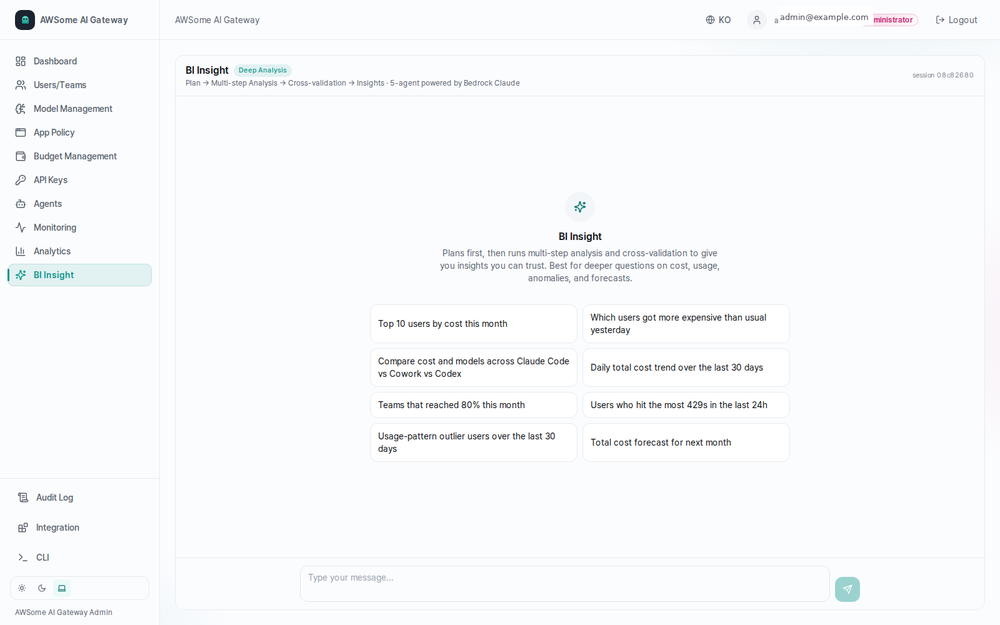
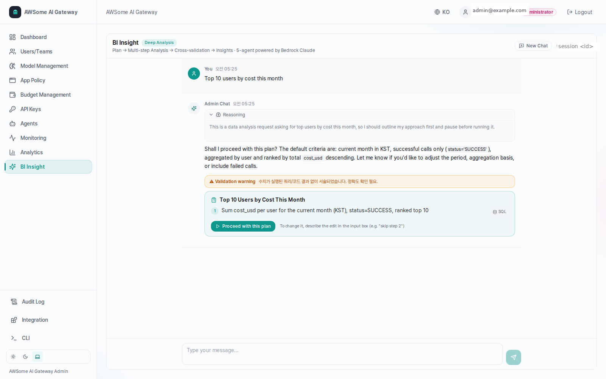

# BI Insight

**Route:** `/chat` · **Role:** Administrator

Conversational analytics — the admin-side chat agent that plans,
queries usage data, cross-validates, and returns insights. It is the
UI for the BI Insight agent described in
[chat-agent.md](../chat-agent.md).

## Layout

- **Session banner** — *Plan → Multi-step Analysis → Cross-validation →
  Insights*, labelled `5-agent powered by Bedrock Claude`, with the
  current session ID on the right.
- **Suggested prompts** — starter questions for common analyses.
- **Message list** — the conversation; report artifacts (tables,
  charts, PDF cards) render inline.
- **Composer** — the input box with the send button.

## Behaviour

- A question starts a multi-step run: the orchestrator plans, delegates
  to specialist agents (usage analysis, reporting), validates the
  numbers against the data, then replies.
- Before executing, the agent presents a **plan card** with the proposed
  SQL steps and a **Proceed with this plan** button — the run waits for
  approval unless you edit the plan:

- **Report cards** appear when the run produces a file — clicking a card
  downloads the PDF/CSV after a server-side ownership check.
- The session ID in the banner is a debugging handle — cite it when
  reporting a wrong answer so the run can be traced in the
  [Audit Log](audit-log.md) and backend logs.

## Operational notes

- Only administrators can open this page — the permission map makes
  `/chat` admin-only, so a team leader or developer navigating here is
  redirected to the [403 page](access-denied.md) before it loads.
- Long analyses are streamed — the plan card shows progress step by
  step; closing the tab does not stop the run.
- See [chat-agent.md](../chat-agent.md) for the underlying agent
  deployment, IAM, and troubleshooting runbook.
