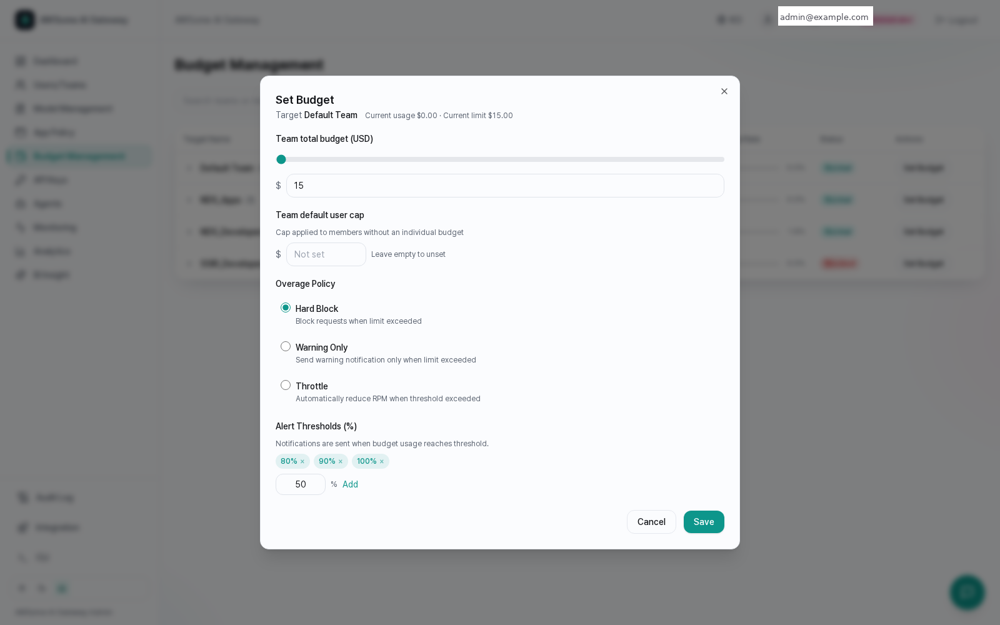
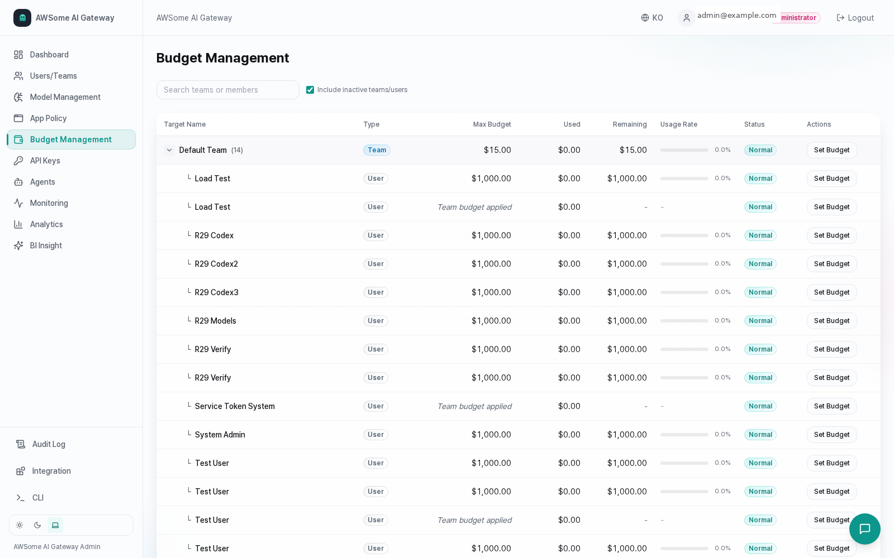

# Budget Management

**Route:** `/budgets` · **Role:** Administrator, Team leader (own team)

Monthly USD caps per team, with per-member visibility and an
auto-downgrade mechanism that throttles spend before the hard limit.

## Filters

| Control | Effect |
|---|---|
| **Search teams or members** | Filter rows by name. |
| **Include inactive teams/users** | Show entities that no longer have active members. |

## Table

| Column | Meaning |
|---|---|
| **Target Name** | Team row (expandable to list members) with member count; a `downgrade N` badge means the team has N auto-downgrade rules configured. |
| **Type** | `Team` or `User`. |
| **Max Budget** | Monthly cap in USD. |
| **Used / Remaining** | Spend so far this month and what is left. |
| **Usage Rate** | Percentage bar — green rising to red as the cap approaches. |
| **Status** | `Normal` or `Blocked` (cap reached — requests are rejected until the cap is raised or the month rolls over). |
| **Actions → Set Budget** | Opens the budget dialog for that target. |

## Set Budget dialog

- **Team total budget (USD)** — the monthly cap. Set or clear it; an
  empty cap means *no limit*.
- **Team default user cap** — cap applied to members without an
  individual budget; leave empty to unset.
- **Overage Policy** — *Hard Block* (reject requests at the cap),
  *Warning Only* (notify but allow), or *Throttle* (reduce RPM past the
  threshold).
- **Alert Thresholds (%)** — notification trigger points; add or remove
  percentage chips.
- The dialog shows **current usage** and an impact summary before
  saving — e.g. "this would immediately block N members".
- Team caps apply to the **sum** of member spend; a member's individual
  cap (set on the member row) stacks underneath.

## Team expansion

Expanding a team row lists its members inline — each member row shows
its own cap (`$1,000.00`), *Team budget applied* when it inherits the
team cap, and a per-member **Set Budget** action:

## Auto-downgrade

Each team can enable **auto-downgrade rules**: when the team's monthly
usage crosses a threshold, requests naming the flagged model are
transparently rewritten to a cheaper model alias instead of being
blocked — spend degrades before it stops.

- Rules are edited in the team's expanded row (**Auto downgrade**
  card): enable the toggle, add *from-model → to-model* rules with a
  usage-% threshold each, and save.
- Rules **chain** — past several thresholds a request resolves to the
  chain's floor model in multiple hops (cycle-safe, 5-hop cap).
- A built-in **usage simulation** slider previews per-model resolution
  at any percentage before saving.
- `downgrade N` on the team row reports N configured rules; **Clear
  settings** removes the policy and restores original routing.

Full setup walkthrough, resolution semantics, and runtime behavior:
[auto-downgrade.md](auto-downgrade.md).

## Operational notes

- Blocking is enforced server-side per request — a blocked response is a
  4xx, not a queue.
- Reservations are conservative: a failed settle leaves budget
  over-counted, never under-counted, so a transient Redis error can
  trigger an early block but never lets spend through.
- Team leaders see only their own team's rows.
