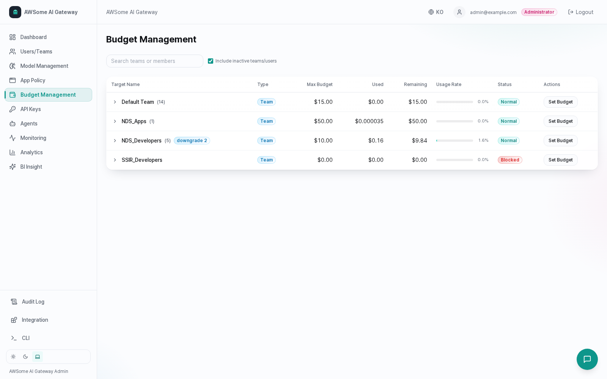

# Budget Management

**Route:** `/budgets` · **Role:** Administrator, Team leader (own team)

Monthly USD caps per team, with per-member visibility and an
auto-downgrade mechanism that throttles spend before the hard limit.

## Filters

| Control | Effect |
|---|---|
| **Search teams or members** | Filter rows by name. |
| **Include inactive teams/users** | Show entities that no longer have active members. |

## Table

| Column | Meaning |
|---|---|
| **Target Name** | Team row (expandable to list members) with member count; a `downgrade N` badge means N members are currently auto-downgraded. |
| **Type** | `Team` or `User`. |
| **Max Budget** | Monthly cap in USD. |
| **Used / Remaining** | Spend so far this month and what is left. |
| **Usage Rate** | Percentage bar — green rising to red as the cap approaches. |
| **Status** | `Normal` or `Blocked` (cap reached — requests are rejected until the cap is raised or the month rolls over). |
| **Actions → Set Budget** | Opens the budget dialog for that target. |

## Set Budget dialog

- Set or clear the monthly cap. An empty cap means *no limit*.
- The dialog shows **current usage** and an **impact summary**
  (`ConfirmImpactBox`) before saving — e.g. "this would immediately
  block N members".
- Team caps apply to the **sum** of member spend; a member's individual
  cap (set on the member row) stacks underneath.

## Auto-downgrade

Each team can enable **auto-downgrade rules**: when a member crosses a
usage threshold, their requests are transparently redirected to a
cheaper model alias instead of being blocked.

- Rules are edited in the team's expanded row
  (`AutoDowngradeConfig`): add thresholds, pick the fallback alias, and
  set alert thresholds.
- `downgrade N` on the team row shows live count; clearing the config
  restores the original model routing.

## Operational notes

- Blocking is enforced server-side per request — a blocked response is a
  4xx, not a queue.
- Reservations are conservative: a failed settle leaves budget
  over-counted, never under-counted, so a transient Redis error can
  trigger an early block but never lets spend through.
- Team leaders see only their own team's rows.
