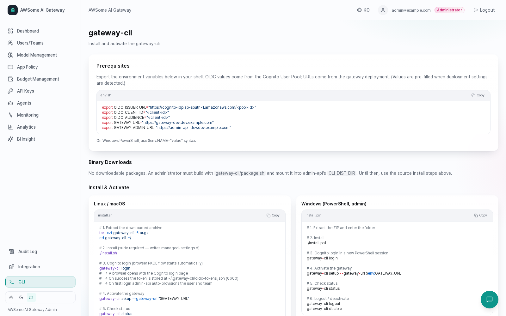

# CLI

**Route:** `/cli` · **Role:** Administrator, Team leader, Developer

Install and activation guide for `gateway-cli` — the CLI that issues
short-lived user virtual keys after Cognito login.



## Prerequisites

The **env.sh** block exports the OIDC and gateway values the CLI needs:

```bash
export OIDC_ISSUER_URL="https://cognito-idp.<region>.amazonaws.com/<pool-id>"
export OIDC_CLIENT_ID="<client-id>"
export OIDC_AUDIENCE="<client-id>"
export GATEWAY_URL="https://<gateway-fqdn>"
export GATEWAY_ADMIN_URL="https://<admin-api-fqdn>"
```

Values are pre-filled from the detected deployment settings; on Windows
PowerShell use `$env:NAME="value"` syntax.

## Binary Downloads

Downloadable packages when the admin has built and mounted them — see
`gateway-cli/package.sh` and `CLI_DIST_DIR`. If none are mounted, the
source install steps below build from the repo.

## Install & Activate

Two tabs — **Linux / macOS** and **Windows (PowerShell, admin)**:

1. Extract the archive and run `install.sh` / `install.ps1`.
2. `gateway-cli login` — opens the Cognito PKCE flow in a browser; on
   success the token is stored at `~/.gateway-cli/oidc-tokens.json`
   (mode `0600`).
3. `gateway-cli setup --gateway-url "$GATEWAY_URL"` — activates the
   gateway; on first login admin-api auto-provisions the user and team.
4. `gateway-cli status` — verify. `gateway-cli logout` / `disable` to
   deactivate.

## Operational notes

- `login` is the only step that opens a browser — everything else is
  local.
- The token file is permissioned `0600`; treat it as a credential.
- `gateway-cli` is how *users* get keys — for *app* keys use
  [Agents](agents.md).
