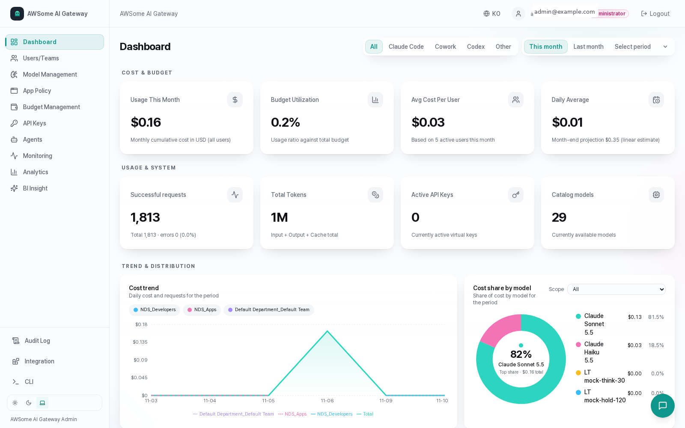
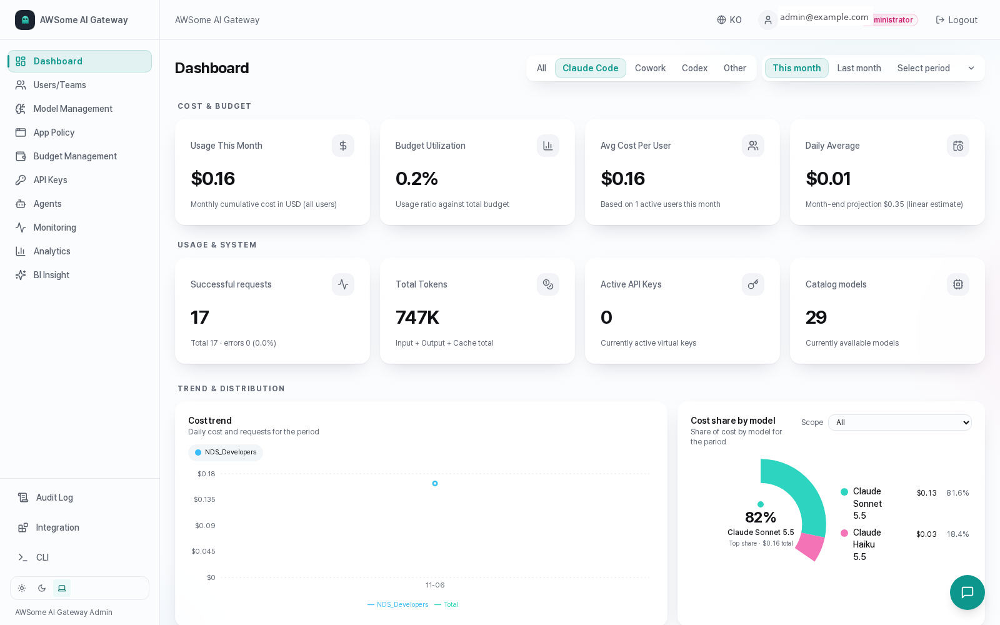

# Dashboard

**Route:** `/` · **Role:** Administrator

Landing page for administrators — a single-pane overview of spend, budget
health, and request volume for the selected period.

## Filters (top-right)

| Control | Effect |
|---|---|
| **Client tabs** — All / Claude Code / Cowork / Codex / Other | Restricts every card and chart to requests issued by that client family. |
| **This month / Last month** | Quick period presets. |
| **Select period** | Any calendar month present in the data. |

All cards and charts update together when a filter changes.

Selecting a client family (here *Claude Code*) narrows every KPI and
chart to that app's traffic:

## Cost & Budget cards

| Card | Meaning |
|---|---|
| **Usage This Month** | Cumulative USD cost for the period (all users). |
| **Budget Utilization** | Percentage of the summed configured budgets already consumed. |
| **Avg Cost Per User** | Total cost ÷ active users in the period. |
| **Daily Average** | Average daily spend, plus a linear month-end projection. |

## Usage & System cards

| Card | Meaning |
|---|---|
| **Successful requests** | Request count with error count and error rate. |
| **Total Tokens** | Input + output + cache tokens combined. |
| **Active API Keys** | Number of virtual keys currently in `ACTIVE` state. |
| **Catalog models** | Models currently registered and usable in the catalog. |

## Trend & Distribution

- **Cost trend** — daily cost line chart, one series per team plus a
  total. Useful for spotting a team whose spend suddenly diverges.
- **Cost share by model** — donut of per-model spend share for the
  period, scoped by the *Scope* dropdown. Confirms which model drives
  the bill.

## Typical workflow

1. Open the Dashboard at the start of a review cycle; set the client tab
   and period you are auditing.
2. Check **Budget Utilization** for abnormal burn, then use the cost
   trend to find which day and team caused it.
3. Drill into [Analytics](analytics.md) for per-model/per-user detail,
   or [Budget Management](budgets.md) to adjust a cap.
