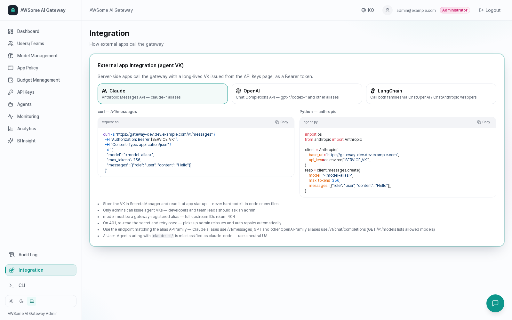
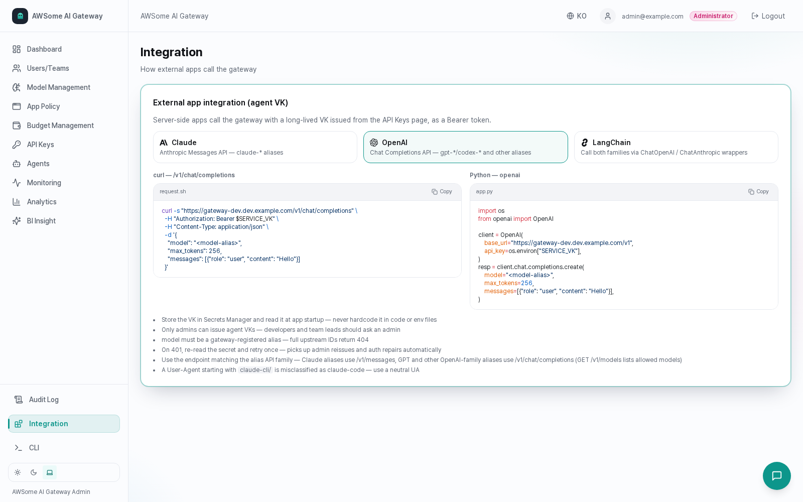
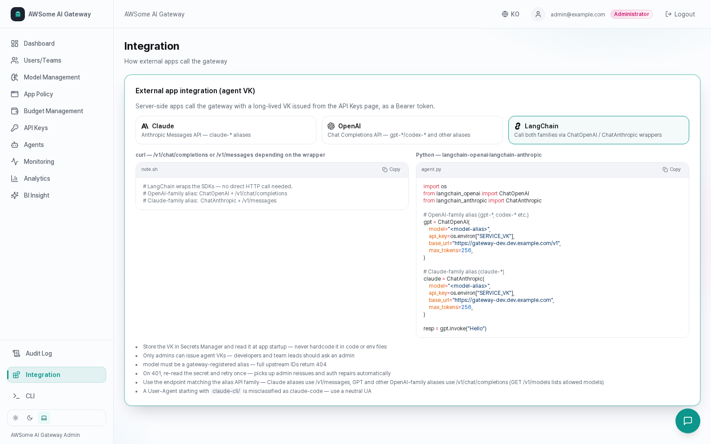

# Integration

**Route:** `/integration` · **Role:** Administrator, Team leader, Developer

Reference page for calling the gateway from external apps — the same
content rendered for every role.

## Sections

### External app integration (agent VK)

Code snippets for calling the gateway with a long-lived agent key:

| Tab | Client family |
|---|---|
| **Claude** | Anthropic Messages API — `claude-*` aliases |
| **OpenAI** | Chat Completions API — `gpt-*`/`codex-*` and other aliases |
| **LangChain** | Both families via `ChatOpenAI` / `ChatAnthropic` wrappers |

Each tab shows a `curl` example and a Python example for the matching
SDK, pre-filled with the deployment's `GATEWAY_URL`.

**OpenAI** tab — `/v1/chat/completions` with the `openai` Python SDK:

**LangChain** tab — `ChatOpenAI` and `ChatAnthropic` wrappers pointed at
the gateway base URL:

## Guidance notes

The notes under the examples capture the operational contract:

- Store the VK in Secrets Manager and read it at app startup — never
  hardcode it.
- Only admins can issue agent VKs — developers ask an admin.
- `model` must be a gateway-registered alias — upstream IDs return 404.
- On 401, re-read the secret and retry — keys are repaired/reissued out
  of band.
- Match the API family to the alias: Claude aliases use `/v1/messages`,
  OpenAI-family aliases use `/v1/chat/completions`.
- A `User-Agent` starting with `claude-cli/` is classified as the
  Claude Code app — use a neutral UA for non-CLI apps.

## CLI download card

Links to the packaged `gateway-cli` binaries (see [CLI](cli.md)).

## Operational notes

- This page is safe to share verbatim with app teams — it shows the
  public endpoint shape, not secrets.
- When a new environment is deployed, the `GATEWAY_URL` examples are
  re-generated from the detected deployment settings — no action is
  needed.
