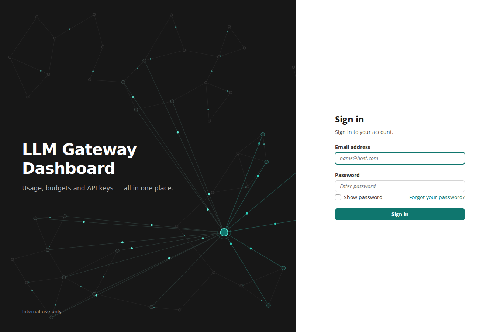
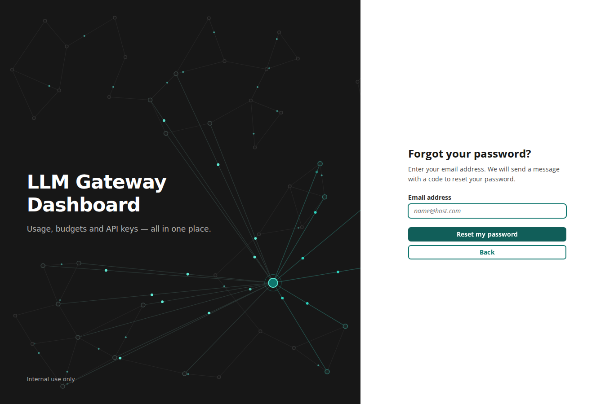

# 로그인

1. [Dev 관리자 콘솔](https://admin-dev.ssir-dev.nds.remu.one/)에 접속합니다. Cognito의 **Sign in** 화면이 열립니다.
2. **Email address**에 dev 계정 이메일을, **Password**에 비밀번호를 입력합니다.
3. **Sign in**을 선택합니다. 관리자 계정은 [Dashboard](admin-screens.md#dashboard)에서 시작합니다.

로그인 직후 **User registration failed**가 표시되면 운영 담당자에게 계정의 팀 그룹 배정과 사용자 등록 상태를 확인해 달라고 요청합니다. **403**이 표시되면 접근하려는 메뉴에 필요한 역할이 계정에 부여되어 있는지 확인합니다.

첫 웹 로그인에서 로그인 콜백이 게이트웨이 사용자와 팀·역할을 등록합니다. CLI에서 사용하는 Virtual Key는 [클라이언트 연결 절차](../client-setup.md)의 `gateway-cli login`에서 발급됩니다. ADFS 버튼이 제공되는 환경의 그룹 매핑은 [AD 연동 가이드](../ad-sync.md)에서 확인합니다.

## 비밀번호 재설정

1. 로그인 화면에서 **Forgot your password?**를 선택합니다.
2. **Email address**에 dev 계정 이메일을 입력하고 **Reset my password**를 선택합니다.
3. 이메일로 받은 코드를 사용해 화면의 안내에 따라 새 비밀번호를 설정합니다. 로그인 화면으로 돌아가려면 **Back**을 선택합니다.

[가이드 목차](README.md) · [관리자 UI 및 기능](admin-ui.md)
