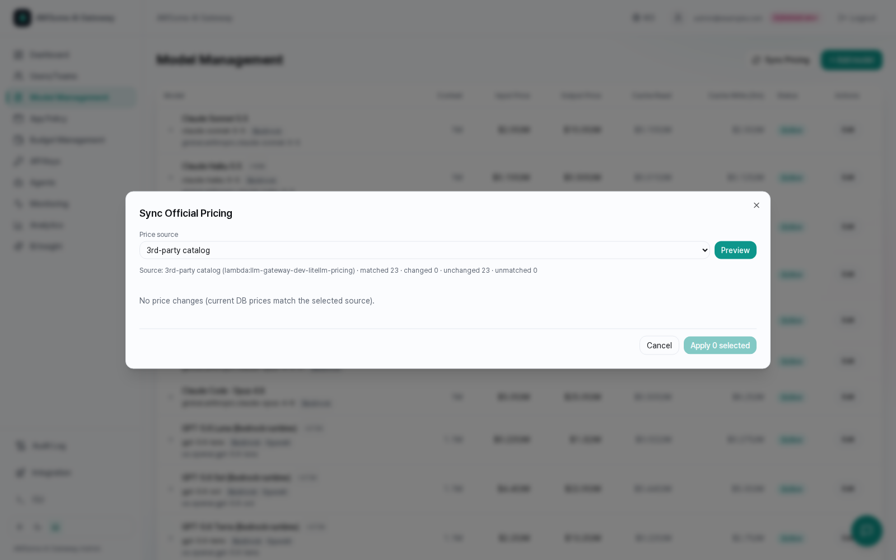
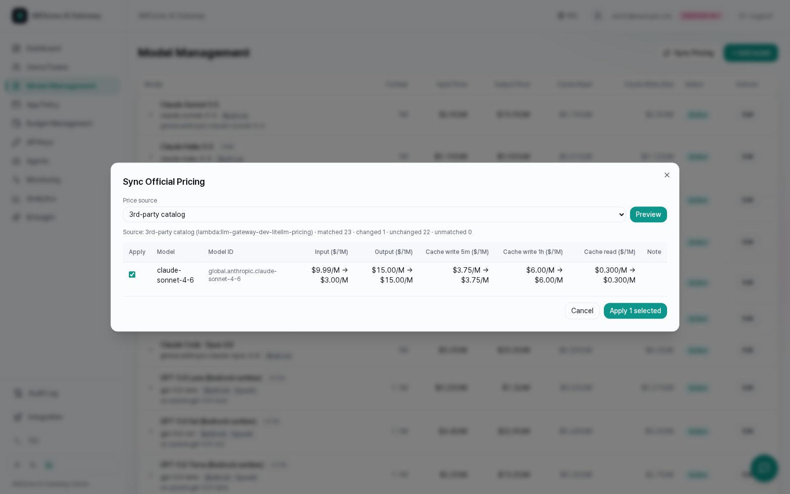

# Model Management

**Route:** `/models` · **Role:** Administrator

Model catalog — the list of model **aliases** that clients are allowed
to call, with pricing, context limits, status, and per-team permissions.

## Header controls

| Control | Effect |
|---|---|
| **Sync Pricing** | Re-pulls the pricing feed and refreshes Input/Output/Cache columns. |
| **+ Add model** | Opens the create-model dialog. |

### Sync Pricing

**Sync Pricing** opens a source picker with **two feeds**:

| Source | What it is | Requirement |
|---|---|---|
| **AWS Price List** | AWS 공식 Price List API — Bedrock 모델 단가 | 없음 — 항상 사용 가능 |
| **3rd-party catalog** (LiteLLM) | LiteLLM canonical cost map — 써드파티·크로스프로바이더 단가 포함 | `features.pricing_lambda: true` — `llm-gateway-<env>-litellm-pricing` Lambda가 프로비저닝돼 있어야 함. 미배포 시 이 옵션은 **비활성**으로 표시되고 API는 503 |

The **Preview** step is mandatory — nothing is written until you apply:

The preview header reports the effective source (for LiteLLM, the Lambda
name — e.g. `lambda:llm-gateway-dev-litellm-pricing`) and the match
counts. The diff table lists changed rows with current → proposed
input/output/cache prices — check the rows you want, **Apply selected**
writes only those:

Aliases with no mapping in the source are listed as **unmatched** and
keep their current price — a sync never blanks an existing price.

> Changing the source after a preview clears the result — always
> re-preview on the source you intend to apply (a server-side drift
> guard rejects a mismatched apply anyway).

## Table columns

| Column | Meaning |
|---|---|
| **Model** | Display name + the gateway **alias** clients send, plus a provider badge (Bedrock, Mantle · OpenAI, …). Expand a row for the full detail and team-permission panel. |
| **Context** | Context window size (e.g. `200K`, `1M`). A `>` marker indicates a long-context tier above a threshold. |
| **Input / Output Price** | USD per million tokens. `—` means pricing not yet synced. |
| **Cache Read / Cache Write (5m)** | Cache token pricing where supported. |
| **Status** | `Active` models can be called; deactivated models stay listed for historical reporting. |
| **Actions → Edit** | Opens the edit dialog. |

### Expanded row

Clicking a row expands it in place — the token-pricing detail (including
the two cache-create tiers and cache read) and a **Model Info** card with
provider, upstream model ID, context/max-output, endpoint URL, and the
registration date. The **Deactivate** and **Delete** actions and the
team-permission panel live inside the expansion.

## Add / Edit model dialog

Fields, top to bottom:

| Field | Required | Meaning |
|---|---|---|
| **Alias** | ✓ | The string clients send as `model`. App policy, team permissions, budgets, and usage records all key off the alias — upstream IDs live behind it, so a backend swap doesn't touch clients. |
| **Provider** | ✓ | Backend family (Bedrock, Mantle·OpenAI, …) — controls which extra fields appear. |
| **Model ID** | ✓ | Upstream identifier — e.g. a `global.anthropic.*` / `us.anthropic.*` inference profile or a provider model ID. |
| **Endpoint URL** | conditional | Only for providers that need an explicit endpoint. |
| **Pricing (per 1M)** | input/output ✓ | Input, output, cache-create 5m, cache-create 1h, cache-read rates. Can be filled later via **Sync Pricing** if the source covers the model. |
| **Long-context band** | optional | Threshold (tokens) + the five price fields that apply above it — for models with tiered long-context pricing. Leaving all six blank keeps the model single-tier; there is intentionally no "remove tier" path. |
| **Specs** | optional | Context window, max output tokens — informational display in the catalog. |
| **Routing (optional)** | — | `account_role_arn` + `region` + `external_id` — per-model cross-account override (see op-guide §9.3). |
| **Description** | optional | Free-text catalog note. |
| **Display name** | optional | Label shown in the UI. |

## Registering a new model — operator walkthrough

1. **Prerequisite** — the serving account must be able to invoke the
   model. New Anthropic models are **Marketplace subscriptions** (Bedrock
   console → Model catalog → Subscribe in the target account), not
   model-access requests.
2. **Add model** → fill alias / provider / model ID. Keep the alias
   stable — clients and policies bind to it.
3. **Pricing** — enter rates now, or leave the catalog defaults and run
   **Sync Pricing** afterwards (AWS Price List for Bedrock IDs;
   3rd-party catalog for wider coverage — needs `pricing_lambda`).
4. **Permissions** — expand the new row → team-permission panel to grant
   teams access; the alias is not callable until a policy allows it.
5. **Routing (optional)** — cross-account ARN if the model is served
   from another account.
6. **Verify** — a test call through the gateway, then confirm the row
   shows in Analytics.

## Deactivate vs delete

- **Deactivate** removes the alias from routing immediately while
  preserving usage history — preferred for retiring a model.
- **Delete** removes the catalog entry entirely; the dialog shows the
  impact counts (usage logs retained; pricing/permissions/rate limits
  removed) and requires typing the alias to confirm. A model that is a
  **downgrade target** for another alias cannot be deleted until the
  reference is removed. **Usage history survives deletion** — deleted
  models can still appear in Analytics and audit history.

## Related

- Which apps may call which aliases is managed in
  [App Policy](app-policy.md).
- Team-level model permission is edited in each model's expanded row
  (`TeamModelPermissionPanel`).
