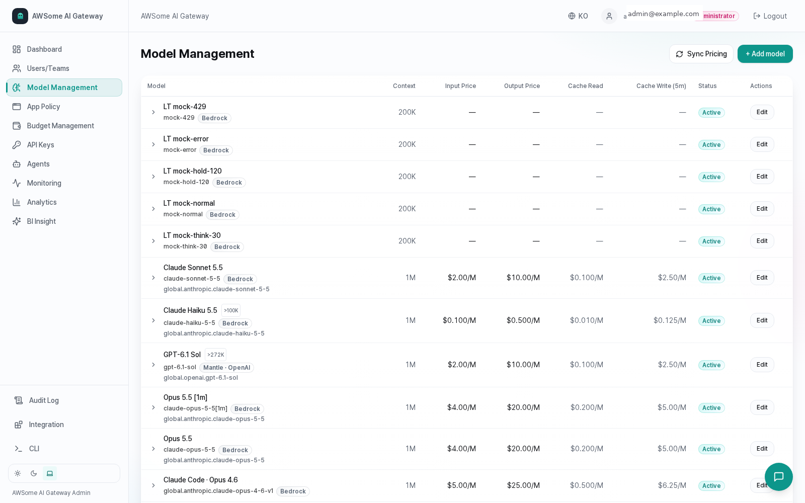
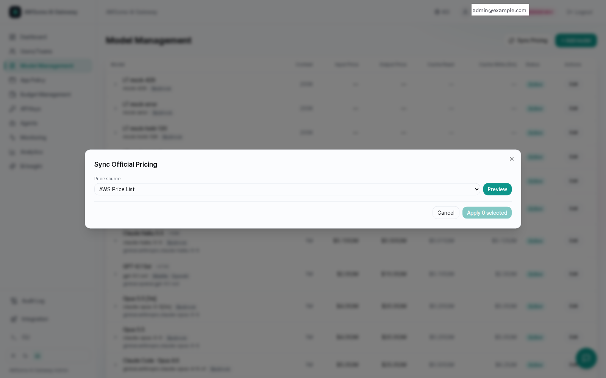
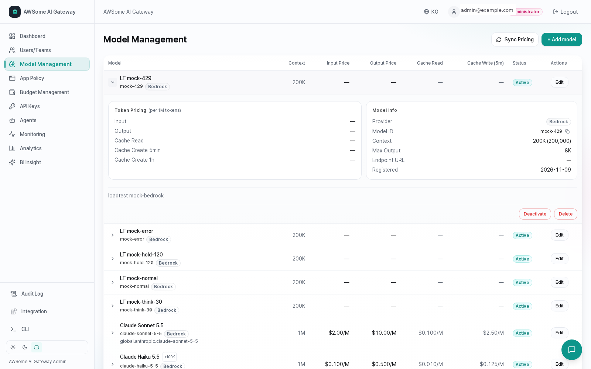
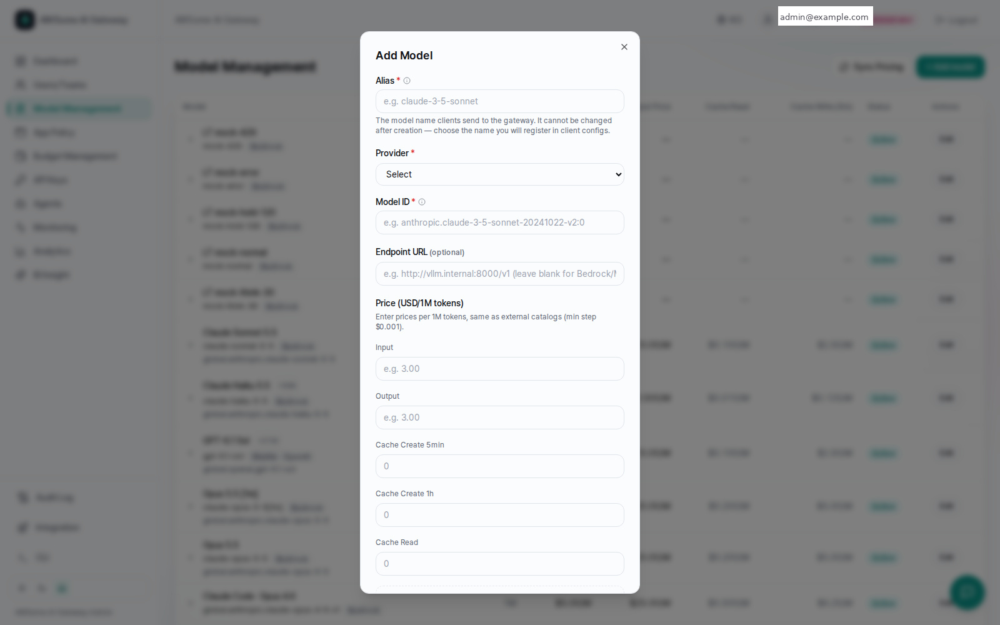
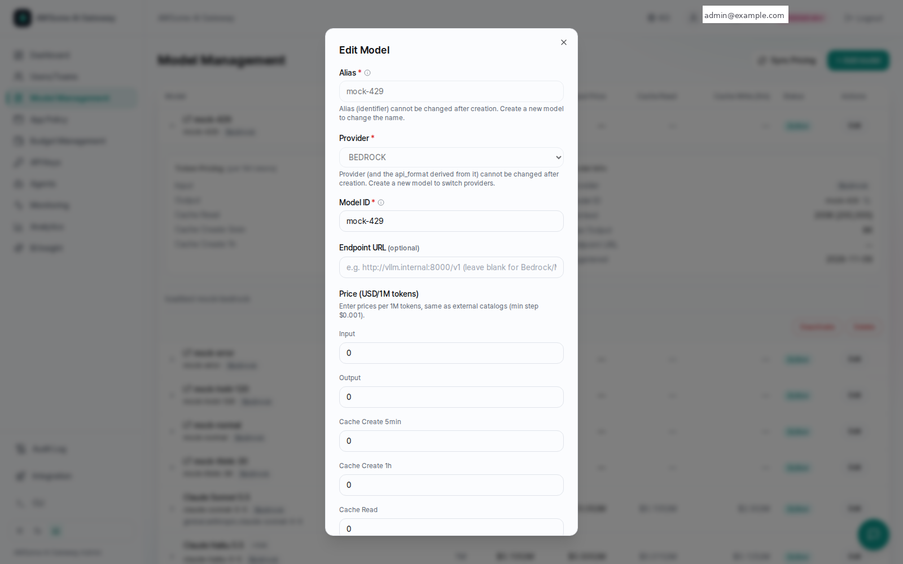

# Model Management

**Route:** `/models` · **Role:** Administrator

Model catalog — the list of model **aliases** that clients are allowed
to call, with pricing, context limits, status, and per-team permissions.

## Header controls

| Control | Effect |
|---|---|
| **Sync Pricing** | Re-pulls the pricing feed and refreshes Input/Output/Cache columns. |
| **+ Add model** | Opens the create-model dialog. |

### Sync Pricing

**Sync Pricing** opens a source picker — *AWS Price List* or a LiteLLM-style
community catalog — with a **Preview** step before anything is written:

Preview lists the models whose prices would change; **Apply** writes only
the selected rows. Models with no mapping keep their current price — a sync
never blanks an existing price.

## Table columns

| Column | Meaning |
|---|---|
| **Model** | Display name + the gateway **alias** clients send, plus a provider badge (Bedrock, Mantle · OpenAI, …). Expand a row for the full detail and team-permission panel. |
| **Context** | Context window size (e.g. `200K`, `1M`). A `>` marker indicates a long-context tier above a threshold. |
| **Input / Output Price** | USD per million tokens. `—` means pricing not yet synced. |
| **Cache Read / Cache Write (5m)** | Cache token pricing where supported. |
| **Status** | `Active` models can be called; deactivated models stay listed for historical reporting. |
| **Actions → Edit** | Opens the edit dialog. |

### Expanded row

Clicking a row expands it in place — the token-pricing detail (including
the two cache-create tiers and cache read) and a **Model Info** card with
provider, upstream model ID, context/max-output, endpoint URL, and the
registration date. The **Deactivate** and **Delete** actions and the
team-permission panel live inside the expansion.

## Add / Edit model dialog

Fields include:

- **Alias** — the name clients pass in `model`. Aliases are what app
  policy and team permissions reference; upstream model IDs live behind
  the alias.
- **Display name**, **provider/backend**, optional **endpoint URL**.
- **Pricing** — input/output/cache rates, and the long-context override
  band (threshold + prices that apply above it).
- **Group** and **description** for catalog organization.

## Deactivate vs delete

- **Deactivate** removes the alias from routing immediately while
  preserving usage history — preferred for retiring a model.
- **Delete** removes the catalog entry entirely; the UI gates this on
  models with no dependent references.

## Related

- Which apps may call which aliases is managed in
  [App Policy](app-policy.md).
- Team-level model permission is edited in each model's expanded row
  (`TeamModelPermissionPanel`).
