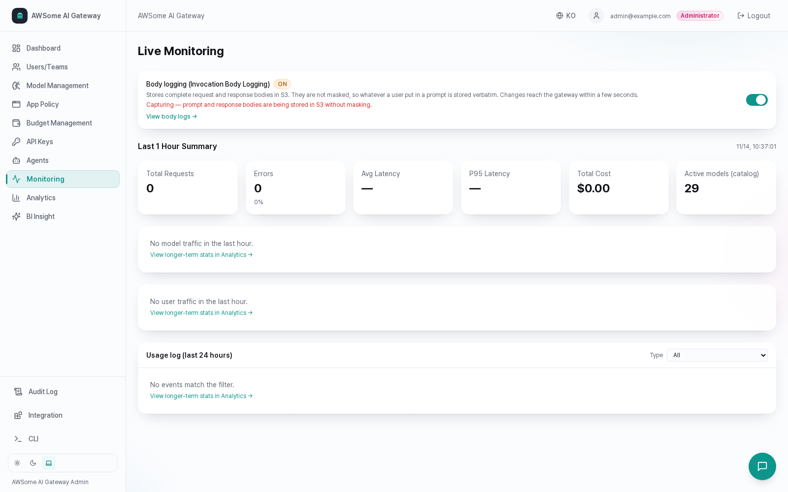
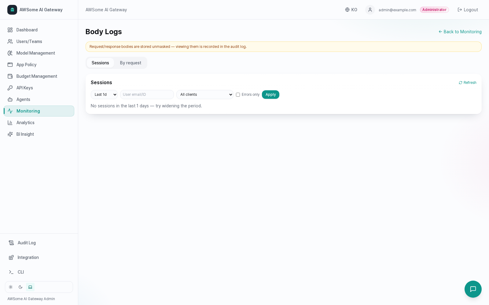

# Monitoring

**Route:** `/monitoring` · **Role:** Administrator

Live health and traffic view — request rates, latency, errors, and the
body-logging control that governs what is captured for deep inspection.

## Body logging banner

The top banner shows the **Invocation Body Logging** state:

- **ON** — complete request/response bodies are being stored in S3.
  They are **not masked** — whatever a user put in a prompt is stored
  verbatim.
- Toggle it off to stop capture; changes reach the gateway within a few
  seconds.
- The caption **"Capturing — prompt and response bodies are being stored
  in S3 without masking"** stays visible while it is on.

## Last 1 Hour Summary

| Card | Meaning |
|---|---|
| **Total Requests** | Requests in the last hour. |
| **Errors** | Count and percentage of failed requests. |
| **Avg / P95 Latency** | Round-trip latency to the model endpoint. |
| **Total Cost** | USD spent in the window. |
| **Active models (catalog)** | Models currently usable — the catalog ceiling, not what was actually called. |

Below the cards are **model traffic** and **user traffic** tables for the
same window — which models and users carried the load.

## Usage log

Chronological event feed for the last 24 hours, filterable by **Type**
(API request, auth, admin action, …). Each entry expands for the
request metadata.

## Operational notes

- Body logging is a debugging tool, not an always-on audit — turn it on
  while reproducing a problem, then off again. Storage is unmasked S3
  and views are recorded in the audit log.
- The page reads from the live metrics path, not the aggregated
  analytics store — figures can differ from
  [Analytics](analytics.md) for the same window.

## Body Logs

**Route:** `/monitoring/body-logs` · **Role:** Administrator

Browser over the captured request/response bodies — two views:

- **Sessions** — grouped by session ID, filterable by period, user, and
  client.
- **By request** — individual captured bodies.

Every view of a body is written to the [Audit Log](audit-log.md) as a
`View body log` event — the top banner states this explicitly because
the contents are unmasked.
