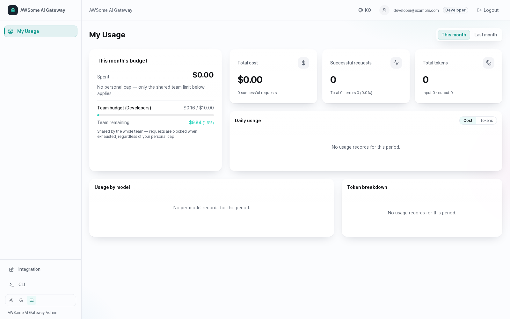

# My Usage

**Route:** `/my` · **Role:** Team leader, Developer *(not Administrator)*

Self-service usage view — the same data an admin sees in
[Analytics](analytics.md), scoped to the signed-in user.

## Cards

| Card | Meaning |
|---|---|
| **This month's budget** | Personal cap, then the shared team budget with remaining amount — the team cap blocks *all* members when exhausted regardless of personal cap. |
| **Total cost** | Personal USD spend for the period. |
| **Successful requests** | Own request count with error rate. |
| **Total tokens** | Input + output + cache tokens used. |

## Charts

- **Daily usage** — cost (or tokens) per day.
- **Usage by model** — per-model spend share.
- **Token breakdown** — input/output/cache split.

## Period selector

*This month / Last month / Select period* — same month semantics as
the Dashboard, but scoped to the signed-in user's own rows.

## Why admins get 403

This page is **Team leader + Developer only** by design — an admin's
"own usage" would blur the role boundary; the admin's view is the
system-wide [Dashboard](dashboard.md) and [Analytics](analytics.md).
An admin who navigates to `/my` lands on the
[403 page](access-denied.md).

## Operational notes

- The budget card shows *both* caps — a user can have headroom on their
  personal cap yet still be blocked if the shared team budget is spent.
- Use it as the first answer to "why was my request rejected" — the
  daily chart and remaining budget usually explain it.
