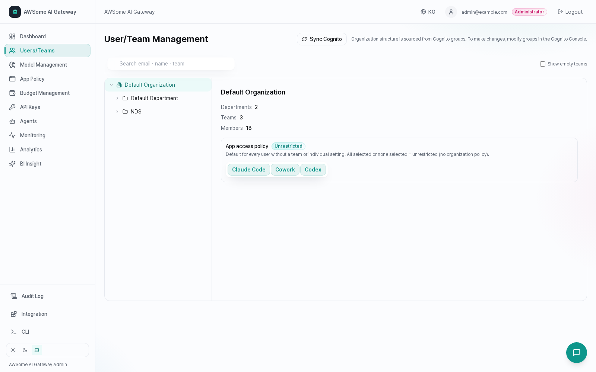

# Users/Teams

**Route:** `/users` · **Role:** Administrator
*(also serves `/rate-limits`, which redirects here — rate limits are
configured per scope on this page)*

Organization browser and per-scope policy editor. The organization tree
(organization → department → team → member) is **sourced from Cognito
groups** — structure changes are made in the Cognito console and pulled
in with **Sync Cognito**.

## Header controls

| Control | Effect |
|---|---|
| **Sync Cognito** | Pulls users/groups from Cognito into admin-api. Runs the fail-closed reconciler — incomplete fetches deactivate nothing. |
| **Search email · name · team** | Filters the tree to matching nodes. |
| **Show empty teams** | Includes teams with zero members. |

## Organization tree (left pane)

Select any node to load its detail panel:

- **Organization / Department / Team** — member counts, app access
  policy, and scope-level settings.
- **Member** — user detail including role, team, and effective policy.

## Detail panel (right pane)

For an organization node the panel shows counts and the **App access
policy** card:

- Chips for **Claude Code / Cowork / Codex**.
- *Unrestricted* = no organization-level restriction (all chips selected
  or none selected behaves the same).
- Selecting a subset restricts every user under the node who has no more
  specific team or individual override.

Team and member nodes additionally expose:

- **App access** (`ScopeAppAccessPanel`) — per-scope allowlist of client
  apps. More specific scopes override the organization default.
- **Rate limits** (`ScopeRateLimitPanel`) — request/token limits per
  scope; teams can inherit the organization default, and members can
  inherit the team default or carry an individual cap.
- **Effective policy** (`EffectivePolicyCard`) — the resolved result of
  all layers for that scope, so you can verify what actually applies.

## Operational notes

- Membership and org structure changes belong in Cognito (or your IdP
  group mapping), **not** this console — the UI is read-only for tree
  structure except app-access and rate-limit policy.
- **Team leader** designation is done here (it is not a Cognito group);
  the flag survives Cognito syncs.
- After syncing, check the summary for `reconcile_incomplete` warnings —
  they mean a fetch failed and deactivation was skipped on purpose.

## Related

- Per-user usage is visible to admins in
  [Analytics](analytics.md) filtered by user — members see their own
  numbers on their `/my` page (not accessible to admins).
- The old `/rate-limits` URL lands here with `?from=rate-limits`.
