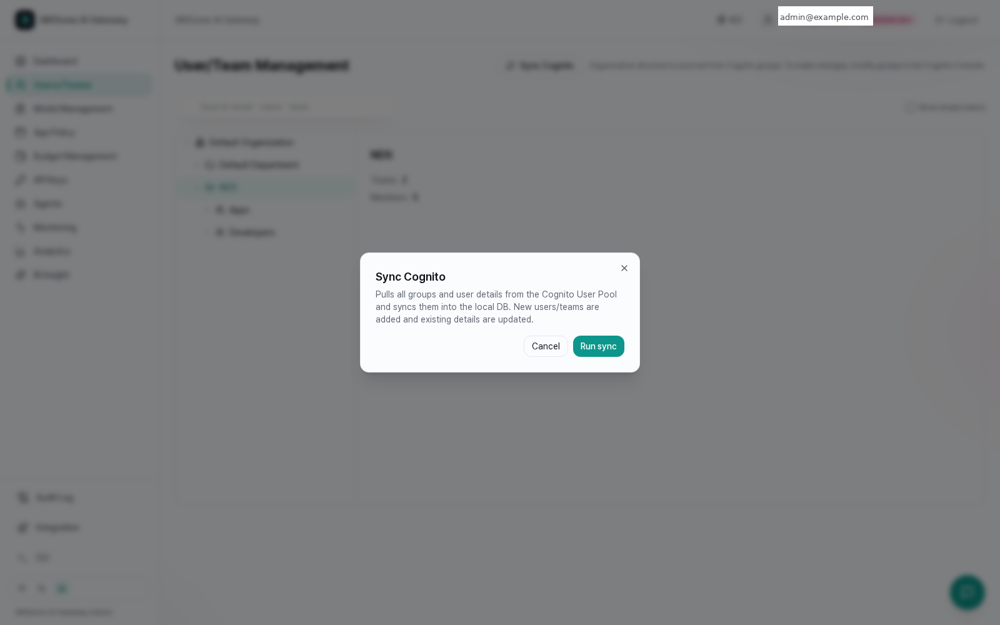
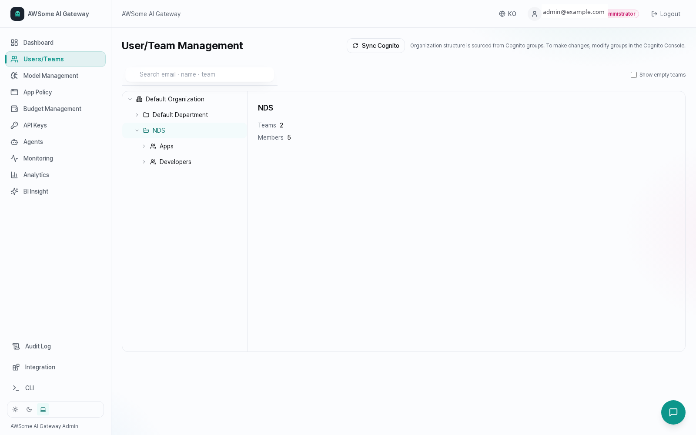
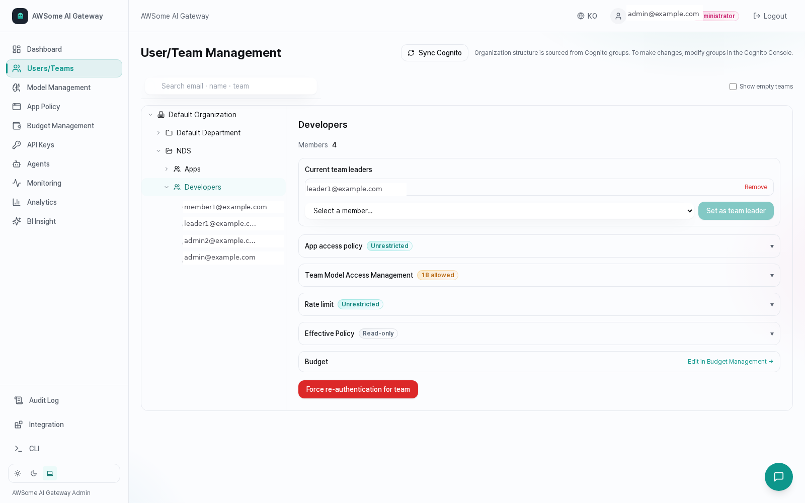
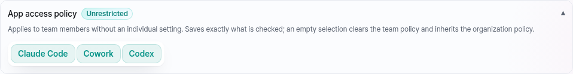
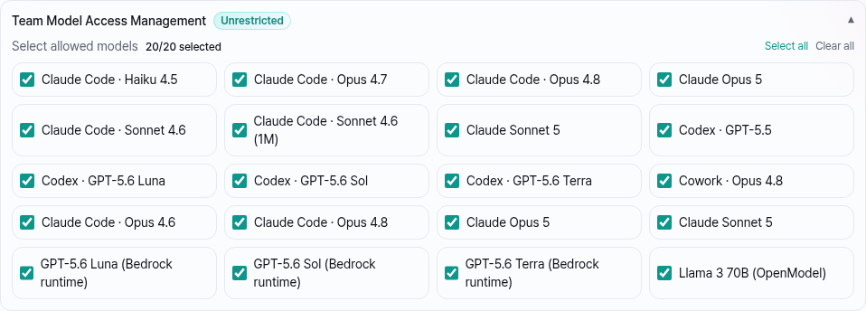
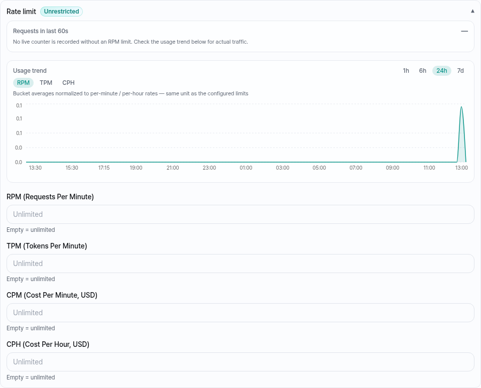
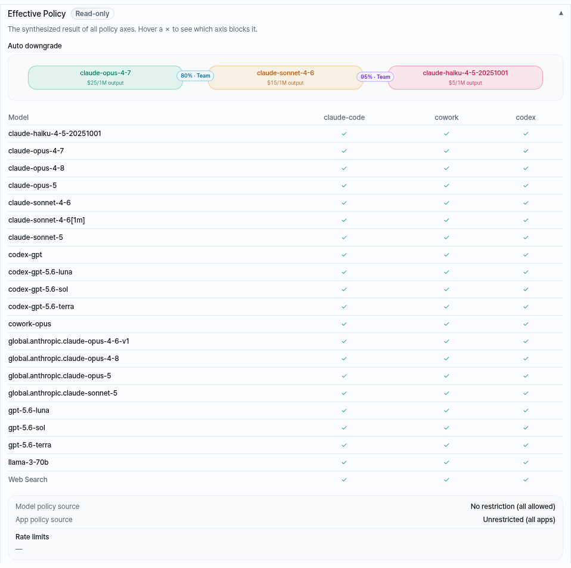
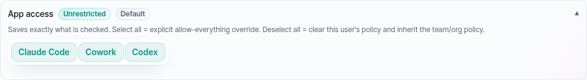
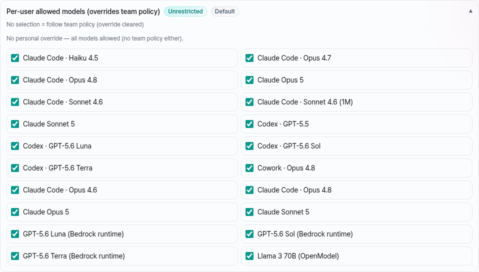
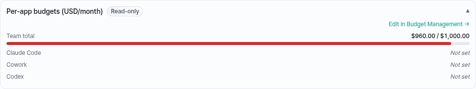

# Users/Teams

**Route:** `/users` · **Role:** Administrator
*(also serves `/rate-limits`, which redirects here — rate limits are
configured per scope on this page)*

Organization browser and per-scope policy editor. The organization tree
(organization → department → team → member) is **sourced from Cognito
groups** — structure changes are made in the Cognito console and pulled
in with **Sync Cognito**.

## Header controls

| Control | Effect |
|---|---|
| **Sync Cognito** | Pulls users/groups from Cognito into admin-api. Runs the fail-closed reconciler — incomplete fetches deactivate nothing. |
| **Search email · name · team** | Filters the tree to matching nodes. |
| **Show empty teams** | Includes teams with zero members. |

**Sync Cognito** asks for confirmation before running — it pulls all
groups and user details from the Cognito User Pool into the local DB:

## Organization tree (left pane)

Expanding the tree shows the hierarchy — organization, departments,
then teams with their member counts:

Select any node to load its detail panel:

- **Organization / Department / Team** — member counts, app access
  policy, and scope-level settings.
- **Member** — user detail including role, team, and effective policy.

## Detail panel (right pane)

For an organization node the panel shows counts and the **App access
policy** card:

- Chips for **Claude Code / Cowork / Codex**.
- *Unrestricted* = no organization-level restriction (all chips selected
  or none selected behaves the same).
- Selecting a subset restricts every user under the node who has no more
  specific team or individual override.

A **team node** shows the full per-team editor:

- **Current team leaders** — list with **Remove** per leader, plus a
  member picker and **Set as team leader** to designate another. Team
  leader is a console flag, not a Cognito group.
- **Force re-authentication for team** — invalidates every member's
  active virtual keys; users must run `gateway-cli login` again.
- **Budget** — read-only pointer to [Budget Management](budgets.md).

Below those controls, the panel stacks collapsible **policy sections**.
Every section is edited through a single floating **Apply** bar — edits
in different sections are staged independently and saved together (a
failed section keeps its unsaved state and shows a `failed` chip while
the others commit).

### Team sections (expanded)

**App access policy** — allowlist of client apps applied to members
without an individual override. Saves exactly what is checked; an empty
selection *clears* the team policy (members inherit the organization
policy, it does not mean "deny all"):

**Team Model Access Management** — catalog aliases the team may call.
`N/20 selected` counter with **Select all / Clear all**; a subset
selection restricts every member without a personal override:

**Rate limit** — RPM/TPM/CPM/CPH fields per scope. *Unrestricted* means
no own limit (the organization default applies if one exists). The panel
shows a live *requests in last 60s* counter and a usage-trend chart:

**Effective Policy** — read-only synthesized result of every policy axis
for this team: the auto-downgrade chain, the model × client matrix, and
the source of each policy (own / inherited / default):

### Member sections (expanded)

A **member node** shows the same axes at user scope, plus a per-app
budget view:

**App access** — individual override of the team/org policy. The checked
set is saved literally: *select all* is an explicit allow-everything
override; *deselect all* clears the user policy and falls back to the
team/org policy. An inheritance caption states which policy currently
applies:

**Per-user allowed models** — overrides the team model policy. No
selection = follow team policy; with no team policy either, all models
are allowed:

**Rate limit** — same fields as the team editor (RPM/TPM/CPM/CPH) at
user scope; empty inherits the team limit:

**Per-app budgets** — read-only gauges of the member's team total and
per-app budget slices; edit them in
[Budget Management](budgets.md) via the inline link:

**Effective Policy** — the resolved result of all layers for this user,
including the team auto-downgrade chain and which axis (own/team/org)
produced each value:

Member nodes also carry per-user status controls — activate/deactivate
the account, assign or remove the team-leader flag, and force
re-authentication for that individual user.

## Operational notes

- Membership and org structure changes belong in Cognito (or your IdP
  group mapping), **not** this console — the UI is read-only for tree
  structure except app-access and rate-limit policy.
- **Team leader** designation is done here (it is not a Cognito group);
  the flag survives Cognito syncs.
- After syncing, check the summary for `reconcile_incomplete` warnings —
  they mean a fetch failed and deactivation was skipped on purpose.

## Related

- Per-user usage is visible to admins in
  [Analytics](analytics.md) filtered by user — members see their own
  numbers on their `/my` page (not accessible to admins).
- The old `/rate-limits` URL lands here with `?from=rate-limits`.
